# CondoManager

## Documento técnico integral de avances, análisis, diseño e implementación

**Sistema automatizado de gestión de pagos, morosidad y reservas para condominios**

| Dato de control | Valor |
|---|---|
| Versión del documento | 1.0 |
| Fecha de corte del análisis | 21 de octubre de 2026 |
| Repositorio analizado | CondoManager |
| Rama de referencia | `develop` |
| Commit de referencia | `a41ea27015072e590ebc3e26e33caed1cda5080a` |
| Versión declarada de la aplicación | `0.1.0` |
| Idioma | Español |
| Tipo de documento | Memoria técnica del avance del proyecto |
| Uso previsto | Base para informe en Word, exposición y consulta técnica |
| Fuentes principales | Código, migraciones, contratos, especificaciones, planificación y entregas documentadas |

### Propósito y criterio de lectura

Este documento reúne el contexto del negocio, los requisitos, los modelos de análisis, la arquitectura, la implementación y la evidencia disponible de CondoManager. Su propósito es explicar de forma extensa **qué se ha construido, cómo funciona, qué reglas lo sustentan y qué trabajo queda para completar la solución**.

El análisis corresponde al contenido del repositorio en la versión indicada. La revisión del código y de la configuración es estática. Los resultados de pruebas de entregas anteriores se identifican expresamente como **resultados publicados por el equipo**; no representan una nueva ejecución realizada para redactar esta memoria. Tampoco se considera que un servicio esté desplegado únicamente porque exista su Dockerfile o su workflow.

Se emplean las siguientes categorías de avance a lo largo del documento:

| Categoría | Significado |
|---|---|
| **Implementado con persistencia** | Existe lógica conectada a repositorios y modelos SQL, acompañada de migraciones y/o pruebas de persistencia. No implica aceptación formal de todo el proceso. |
| **Implementación parcial** | Hay reglas o integración HTTP reales, pero faltan componentes necesarios para completar el recorrido. |
| **Piloto o simulación** | Se emplean diccionarios en memoria, datos sintéticos o transportes simulados. |
| **Especificado** | Está descrito en requisitos, contratos o modelos, sin implementación operativa suficiente en el corte analizado. |
| **Propuesto** | Es una evolución futura y no forma parte de la entrega funcional actual. |

La existencia de una tabla, una pantalla, un escenario Gherkin o una respuesta de éxito no equivale, por sí sola, a que un proceso de negocio esté terminado de extremo a extremo.

---

## Índice general

1. [Resumen ejecutivo](#1-resumen-ejecutivo)
2. [Contexto, problema y justificación](#2-contexto-problema-y-justificación)
3. [Objetivos, alcance y caso piloto](#3-objetivos-alcance-y-caso-piloto)
4. [Actores, roles y organización](#4-actores-roles-y-organización)
5. [Metodología y requisitos](#5-metodología-y-requisitos)
6. [Procesos de negocio](#6-procesos-de-negocio)
7. [Casos de uso](#7-casos-de-uso)
8. [Diagramas de actividad](#8-diagramas-de-actividad)
9. [Modelado BPMN](#9-modelado-bpmn)
10. [Arquitectura del sistema](#10-arquitectura-del-sistema)
11. [Tecnologías y organización del código](#11-tecnologías-y-organización-del-código)
12. [Modelo de datos y migraciones](#12-modelo-de-datos-y-migraciones)
13. [Implementación del backend](#13-implementación-del-backend)
14. [Implementación del frontend](#14-implementación-del-frontend)
15. [Autenticación, autorización y auditoría](#15-autenticación-autorización-y-auditoría)
16. [Reglas financieras y ejemplos](#16-reglas-financieras-y-ejemplos)
17. [Automatización, eventos y recuperación](#17-automatización-eventos-y-recuperación)
18. [Inventario de API y contratos](#18-inventario-de-api-y-contratos)
19. [Infraestructura, configuración y operación](#19-infraestructura-configuración-y-operación)
20. [Integración continua y publicación](#20-integración-continua-y-publicación)
21. [Pruebas y calidad](#21-pruebas-y-calidad)
22. [Avances por sprint y trazabilidad](#22-avances-por-sprint-y-trazabilidad)
23. [Limitaciones y deuda técnica](#23-limitaciones-y-deuda-técnica)
24. [Hoja de ruta y criterios de cierre](#24-hoja-de-ruta-y-criterios-de-cierre)
25. [Guion de demostración y evidencia](#25-guion-de-demostración-y-evidencia)
26. [Conclusiones](#26-conclusiones)
27. [Glosario](#27-glosario)
28. [Referencias internas](#28-referencias-internas)
29. [Anexo A: diagrama de casos de uso en PlantUML](#29-anexo-a-diagrama-de-casos-de-uso-en-plantuml)
30. [Anexo B: modelo BPMN 2.0 en XML](#30-anexo-b-modelo-bpmn-20-en-xml)
31. [Anexo C: preparación del informe en Word](#31-anexo-c-preparación-del-informe-en-word)

---

## 1. Resumen ejecutivo

CondoManager es una plataforma web destinada a automatizar y centralizar procesos administrativos y financieros de condominios. Su núcleo funcional comprende la configuración inmobiliaria, la administración de identidades y permisos, la preparación de presupuestos, la emisión de cuotas, el reporte de pagos, la evaluación de deuda y la gestión de reservas de áreas comunes.

El proyecto responde a una operación tradicional basada en hojas de cálculo, comprobantes compartidos por mensajería y revisión manual. Esta forma de trabajo dificulta mantener una fuente de información consistente, identificar duplicados, reconstruir decisiones y aplicar las mismas reglas a todos los residentes.

La solución adopta un backend asíncrono desarrollado con FastAPI y una interfaz construida con Next.js y TypeScript. PostgreSQL proporciona el soporte relacional; SQLAlchemy y Alembic articulan el acceso a datos y la evolución del esquema. Redis se utiliza como destino de eventos del worker de cuotas. Docker y GitHub Actions aportan preparación de entornos, verificaciones y publicación de imágenes.

Al corte de esta memoria, el avance más sólido se encuentra en los siguientes componentes:

- Identidad global de usuarios y autenticación contra PostgreSQL.
- Alta administrativa de cuentas inactivas y habilitación exclusiva por SuperAdmin.
- Roles contextuales revocables y validación persistente de autorización.
- Vínculos de propietarios titulares, copropietarios e inquilinos con departamentos reales.
- Registro de condominios, edificios y unidades, incluida importación CSV.
- Presupuestos mensuales en borrador y aprobados.
- Configuración de distribución equitativa o por alícuota.
- Emisión persistente con cierre de centavos, saldos a favor, lotes y outbox.
- Portales diferenciados con integración HTTP para varias operaciones administrativas y del residente.
- Pruebas de reglas, autorización, persistencia y concurrencia en partes relevantes del sistema.

El avance todavía no completa todo el ciclo financiero y operativo. Los comprobantes de pago, las reservas y la bitácora de notificaciones de los routers actuales se mantienen en memoria. La conciliación HTTP utiliza una cuota sintética y no reduce las cuotas SQL. El transporte de notificaciones devuelve resultados simulados. El reporte de voucher en la interfaz no realiza una subida persistente del archivo.

Por ello, el estado global se describe como **prototipo avanzado con base inmobiliaria, de identidad y financiera persistente, y con integración durable de pagos, reservas y notificaciones todavía en desarrollo**. Egresos, proveedores, incidencias, balances e IA/RPA forman parte de la visión y del backlog, con distintos niveles de especificación, pero no de un circuito funcional completo entregado.

## 2. Contexto, problema y justificación

### 2.1. Contexto administrativo

Un condominio requiere coordinar aportes de mantenimiento, pagos de servicios, uso de infraestructura común, comunicaciones y responsabilidades entre propietarios, residentes y Junta Directiva. Cada periodo genera obligaciones, comprobantes y decisiones que deben conservarse de manera coherente.

Cuando estas tareas se distribuyen entre archivos personales y conversaciones, la información se fragmenta. Un residente puede reportar un pago en un canal, la tesorería registrarlo en una hoja y la persona responsable de reservas continuar utilizando un estado financiero anterior. El problema trasciende la digitalización de formularios: exige conectar las decisiones mediante datos compartidos y reglas verificables.

### 2.2. Problemas identificados

| Problema | Manifestación operativa | Consecuencia |
|---|---|---|
| Información fragmentada | Excel, correo y mensajería contienen versiones diferentes | Dificultad para establecer el saldo correcto |
| Conciliación manual | Comparación visual de vouchers y movimientos | Demoras, duplicidades y errores de imputación |
| Cálculo inconsistente | Repartos o recargos realizados manualmente | Diferencias de centavos y reclamos |
| Dependencia de personas | Conocimiento concentrado en pocos responsables | Riesgo de discontinuidad al cambiar la Junta |
| Reservas desconectadas | La disponibilidad se gestiona sin consultar deuda actual | Aplicación desigual del reglamento |
| Comunicaciones sin trazabilidad | No se conoce qué aviso se generó o falló | Reenvíos manuales y falta de seguimiento |
| Identidades poco estructuradas | Se confunde propietario, inquilino y administrador | Acceso indebido o pérdida de acceso legítimo |
| Sustentos dispersos | Contratos y comprobantes se guardan en distintos lugares | Poca capacidad de reconstrucción y control |

### 2.3. Situación actual del negocio: AS-IS

El proceso manual típico comienza con la determinación de una cuota, continúa con el pago externo del residente y termina con una actualización manual del estado de cuenta. Las reservas y los avisos dependen de que alguien replique esa información.

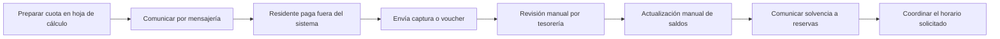

**Figura 1. Proceso AS-IS de referencia.** Representa el problema de negocio descrito en los documentos iniciales; no es una medición de tiempos de una operación observada durante esta revisión.

### 2.4. Propuesta de transformación: TO-BE

El proceso objetivo utiliza identidades y unidades únicas, calcula obligaciones con precisión decimal, conserva los efectos confirmados y deriva comunicaciones desde eventos verificables. La Junta mantiene intervención en decisiones que requieren juicio, como la revisión de evidencia de pago y la atención de excepciones.

La automatización debe reducir tareas repetitivas sin eliminar los controles humanos necesarios. Reportar un voucher no equivale a demostrar que ingresó dinero al banco, y aceptar una solicitud de reserva no debe anticipar el éxito de una transacción que aún puede fallar.

### 2.5. Justificación

**Operativa.** Centralizar padrones, cuotas y permisos disminuye la dependencia de archivos individuales y facilita el trabajo coordinado.

**Financiera.** Los importes decimales, las restricciones de unicidad y el cierre exacto del lote mejoran la consistencia de la información contable.

**Institucional.** La trazabilidad permite explicar quién tomó una decisión y sobre qué información, además de facilitar el relevo de responsables.

**Tecnológica.** La arquitectura modular permite evolucionar dominios sin convertir cada uno en un servicio independiente desde el inicio.

Los beneficios anteriores son objetivos razonados. El repositorio no aporta una medición aprobada de reducción de horas, ahorro económico o disminución de morosidad, por lo que no se presentan como resultados ya obtenidos.

## 3. Objetivos, alcance y caso piloto

### 3.1. Objetivo general

Desarrollar una plataforma web que automatice y haga trazables los procesos de cuotas, pagos, morosidad, comunicaciones y reservas de condominios, con acceso contextual por roles y departamentos.

### 3.2. Objetivos específicos

1. Mantener un padrón persistente de condominios, edificios y departamentos.
2. Administrar identidades globales, roles contextuales y relaciones de tenencia.
3. Preparar y aprobar presupuestos mensuales antes de emitir cuotas.
4. Distribuir importes con precisión decimal y conservar la suma del presupuesto.
5. Aplicar saldos a favor sin duplicar consumos por reintentos.
6. Recibir comprobantes e impedir su reutilización no permitida.
7. Conciliar pagos y reflejar sus efectos financieros de forma durable.
8. Condicionar las reservas a autorización, solvencia y disponibilidad.
9. Generar comunicaciones desde operaciones confirmadas y recuperar fallos temporales.
10. Conservar evidencia técnica suficiente para revisión, pruebas y continuidad del proyecto.

Los objetivos 6 a 9 tienen componentes parciales y condiciones de cierre pendientes en el corte analizado.

### 3.3. Alcance de producto y alcance entregado

| Área | Alcance del producto | Situación al corte |
|---|---|---|
| Identidad y acceso | Usuarios, roles, tenencia y sesiones | Implementación persistente avanzada |
| Configuración inmobiliaria | Condominio, edificios, unidades e importación | Altas, consultas y estado de unidades implementados |
| Finanzas iniciales | Presupuesto, distribución, crédito y emisión | Servicios y persistencia implementados; integración HTTP a verificar en un punto transaccional |
| Pagos | Archivo, recepción, deduplicación y conciliación real | Piloto en memoria; carga de archivo y efectos SQL pendientes |
| Morosidad | Evaluación periódica y actualización durable | Motor puro parcial; ruta HTTP sin consulta real de cuotas |
| Reservas | Catálogo, disponibilidad, creación y cancelación | Reglas y API piloto; persistencia y exclusión entre procesos pendientes |
| Notificaciones | Plantillas, entrega y reintentos recuperables | Plantillas y política parcial; transporte y bitácora simulados |
| Administración ampliada | Egresos, proveedores, tickets y reportes | Especificaciones y elementos de esquema; sin módulo operativo completo |
| IA y RPA | Apoyo a clasificación y tareas repetitivas | Propuesta futura |

### 3.4. Caso piloto

El proyecto utiliza como referencia al Edificio 3 de Villa Bonita 3, con 139 departamentos y 14 pisos habitacionales. El generador del piloto construye 130 unidades en los pisos 1 a 13 y nueve en el piso 14.

| Parámetro | Valor de referencia |
|---|---|
| Unidades | 139 |
| Moneda | PEN |
| Presupuesto mensual de ejemplo | `20850.00` |
| Vencimiento piloto | Día 20 |
| Días de gracia | 2 |
| Mora fija piloto | `20.00` por cuota, bajo las condiciones del modelo |
| Tipos de alícuota | `0.6800`, `0.7400`, `0.8555` y ajuste `0.8560` |
| Suma del padrón generado | `100.0000 %` |

La muestra incorpora casos funcionales: departamento 302 con saldo a favor de `200.00`, departamento 402 con estado `EN_MORA` y departamento 504 en `OBSERVADO`.

| Área piloto | Aforo | Tarifa de referencia |
|---|---:|---:|
| Parrilla 1 | 12 | `25.00` |
| Parrilla 2 | 12 | `25.00` |
| Salón social | 40 | `100.00` |
| Gimnasio | 8 | `0.00` |

`scripts/seed_condominio_piloto.py` genera y valida este dataset en memoria. Su nombre no acredita que cargue automáticamente los 139 registros en PostgreSQL. La preparación persistente de cuentas demo utiliza otro script: `scripts/seed_usuarios_demo.py`.

## 4. Actores, roles y organización

### 4.1. Actores de negocio y del sistema

| Actor | Participación |
|---|---|
| SuperAdmin | Configura condominios, habilita cuentas y administra asignaciones de mayor alcance |
| Junta Directiva / administrador | Gestiona su condominio, presupuestos, unidades y decisiones operativas |
| Residente | Consulta unidades autorizadas, reporta comprobantes y solicita reservas |
| Auditor | Consulta información de su condominio sin modificarla |
| Tesorería | Función de negocio de revisión y conciliación; no es un rol RBAC adicional implementado |
| Sistema automático | Ejecuta emisión programada y publicación de outbox |
| Proveedor de comunicaciones | Participante externo previsto para correo u otros canales |
| Banco o canal de pago | Sistema externo en el que ocurre el abono; no existe integración bancaria operativa acreditada |
| Proveedor de servicios del condominio | Actor de procesos futuros de egresos e incidencias |

### 4.2. Roles canónicos

Los cuatro roles de autorización actuales son `SUPERADMIN`, `ADMIN_JUNTA`, `AUDITOR` y `RESIDENTE`. La concesión global de SuperAdmin se representa mediante una propiedad de la identidad y se provisiona por un procedimiento explícito; no se entrega desde el formulario ordinario de roles contextuales.

Un mismo usuario puede ser residente en un condominio y auditor en otro. Para operar utiliza un contexto determinado. Si tiene varios contextos disponibles, el login puede requerir selección y devolver `CONTEXTO_REQUERIDO`.

### 4.3. Tenencia y solvencia

La relación `usuario_departamentos` expresa tenencia, no un privilegio administrativo. Una persona puede ser propietaria titular de una unidad e inquilina de otra sin dejar de tener el rol `RESIDENTE`.

El estado financiero pertenece a la unidad. Por ello, la deuda de un departamento no debe extrapolarse automáticamente a todas las unidades de una persona. De la misma manera, deshabilitar el acceso de un titular no elimina su relación de propiedad.

### 4.4. Matriz general de permisos

| Operación | SuperAdmin | Junta | Auditor | Residente |
|---|---|---|---|---|
| Crear/listar condominios administrativos | Sí | No | No | No |
| Gestionar edificios y departamentos | Sí | Su contexto | Consulta | No |
| Crear cuentas | Sí | Su contexto | No | No |
| Activar/desactivar cuenta global | Sí | No | No | No |
| Gestionar roles de Junta | Sí, con restricciones | No | No | No |
| Gestionar roles Auditor/Residente | Sí | Según autoridad y contexto | No | No |
| Gestionar vínculos de unidades | Sí | Su contexto | No | No |
| Crear/aprobar presupuesto y emitir | Sí | Su contexto | Consulta | No |
| Reportar comprobante | Sí | Su contexto | No | Unidad autorizada |
| Conciliar comprobante | Sí | Su contexto | Consulta | No |
| Crear/cancelar reserva | Sí | Su contexto | No | Unidad autorizada y reglas aplicables |
| Consultar disponibilidad | Sí | Su contexto | Su contexto | Su contexto autorizado |
| Enviar comunicado | Sí | Su contexto | Consulta de logs | No |

La tabla resume el acceso funcional. Las restricciones específicas de autoedición, conservación de titulares y alcance de consulta se detallan en los casos de uso y en los servicios.

### 4.5. Equipo y responsabilidades

| Integrante | Responsabilidad principal documentada |
|---|---|
| Gerardo | Product Owner y coordinación del sprint |
| Jerson | Arquitectura técnica y base de datos |
| Anderson | Desarrollo full stack |
| Brandon | Desarrollo full stack |
| Alejandro | QA y automatización de pruebas |
| Nicolás / Tarqui | DevOps e integración |

Estas responsabilidades no impiden la participación en implementación, revisión o integración de otros dominios. Las asignaciones recientes se encuentran en los documentos de sprint; algunas especificaciones antiguas conservan distribuciones históricas distintas.

## 5. Metodología y requisitos

### 5.1. Spec-Driven Development

El proyecto utiliza SDD: las reglas, los contratos y los criterios de aceptación se documentan para orientar la implementación. La especificación no se considera un texto separado del producto; forma parte del cambio y debe evolucionar junto al código.

La organización documental contempla cinco niveles:

1. **L0, negocio:** problema, metas y alcance.
2. **L1, arquitectura:** decisiones, políticas y componentes.
3. **L2, dominio:** reglas, procesos y estados.
4. **L3, contratos:** API, datos y eventos.
5. **L4, verificación y operación:** aceptación, pruebas y preparación del entorno.

### 5.2. BDD y criterios de aceptación

Los archivos Gherkin describen comportamientos con la estructura Dado–Cuando–Entonces. Este enfoque permite expresar una regla de negocio sin depender de detalles de interfaz.

```gherkin
Característica: conservación del titular de una unidad
  Escenario: retirar al último propietario titular activo
    Dado que una unidad tiene un único vínculo de propietario titular activo
    Cuando un administrador autorizado intenta revocar ese vínculo
    Entonces el sistema rechaza la operación
    Y conserva la relación y la autorización sin cambios parciales
```

El ejemplo explica una regla existente; no añade un nuevo archivo ejecutable ni acredita una nueva ejecución. En la documentación se localizaron 12 archivos `.feature` con 65 bloques de escenario o esquema de escenario. Los ejemplos parametrizados pueden generar varios casos de prueba, por lo que esos conteos no son equivalentes al número de pruebas ejecutadas.

### 5.3. Requisitos funcionales consolidados

Los siguientes identificadores `RF-DOC` son de organización de esta memoria y no sustituyen las claves REQ, USR, CUE, PAG, NOT, RES o CON del proyecto.

| ID | Requisito | Referencia de planificación |
|---|---|---|
| RF-DOC-01 | Configurar condominios y reglas financieras | CON-2 / USR-01 |
| RF-DOC-02 | Registrar estructura inmobiliaria e importar padrón | CON-3 / USR-02 |
| RF-DOC-03 | Crear cuentas y habilitar acceso | CON-04 / USR-03 |
| RF-DOC-04 | Gestionar vínculos de tenencia | CON-05 / USR-04 |
| RF-DOC-05 | Gestionar roles y revocación | CON-06 / USR-05 |
| RF-DOC-06 | Crear y aprobar presupuesto mensual | CON-9 / CUE-01 |
| RF-DOC-07 | Configurar distribución | CON-10 / CUE-02 |
| RF-DOC-08 | Emitir cuotas y aplicar crédito previo | CON-11 y CON-13 |
| RF-DOC-09 | Reportar comprobante sin duplicación | CON-22 y CON-23 |
| RF-DOC-10 | Conciliar y persistir efectos financieros | PAG y CON-70 |
| RF-DOC-11 | Consultar áreas y disponibilidad | CON-39 y CON-40 |
| RF-DOC-12 | Reservar según solvencia y exclusión horaria | CON-41, CON-42 y CON-43 |
| RF-DOC-13 | Cancelar reservas | CON-46 |
| RF-DOC-14 | Notificar operaciones y recuperar fallos | CON-32, CON-34, CON-36 y CON-37 |

### 5.4. Requisitos no funcionales

| Dimensión | Criterio del proyecto | Situación relevante |
|---|---|---|
| Integridad financiera | Decimal y tipos SQL de precisión fija | Aplicado en backend; persiste una conversión a `Number` en presupuesto frontend |
| Aislamiento | Contexto y unidades autorizadas | Controles en aplicación y pruebas de identidad |
| Trazabilidad | Actor, motivo, resultado y snapshots | Persistencia en módulos avanzados; garantías incompletas en otros |
| Durabilidad | Conservación tras commit y reinicio | Alcanzada en varias bases; pendiente en recursos piloto |
| Concurrencia | Bloqueos y unicidad en PostgreSQL | Implementada en partes financieras e identidad; reservas aún sin garantía distribuida |
| Idempotencia | Reintento sin duplicación de efectos | Lotes y crédito persistentes; pagos limitados al proceso |
| Calidad | Pruebas, contratos y cobertura mínima | Umbral de cobertura backend configurado en 80 % |
| Usabilidad | Portales por rol y estados claros | Interfaz funcional con brechas documentadas |
| Accesibilidad | Semántica, foco y etiquetas | Hay medidas concretas; sin certificación de conformidad |
| Operabilidad | Contenedores y verificación automatizada | Configuración existente; despliegue remoto todavía pendiente |

### 5.5. Gestión del código

`CONTRIBUTING.md` describe ramas de características sobre `develop`, integración estable en `main`, Conventional Commits y revisión por otro integrante. Los workflows comprueban el título del PR y los prefijos de rama. La guía describe una política de revisión; su existencia no demuestra por sí sola que todas las protecciones estén activadas en GitHub.

## 6. Procesos de negocio

### 6.1. PROC-01: cuotas de mantenimiento

Recibe un presupuesto aprobado, el padrón activo y el método de distribución. Produce cuotas por unidad, registros de aplicación de crédito, un lote y un evento pendiente de publicación. La emisión ordinaria persistente utiliza el presupuesto almacenado y no acepta que el cliente imponga el importe total.

El proceso debe conservar el presupuesto bruto aunque una unidad tenga crédito. El saldo a favor cancela parte de la obligación como pago y no reduce artificialmente el total emitido.

### 6.2. PROC-02: pagos y morosidad

Separa reporte de evidencia, revisión y aplicación financiera. El residente declara una operación, la Junta decide y el sistema aplica las consecuencias. El motor de mora considera vencimiento, gracia y revisión pendiente según el diseño.

En el código actual hay servicios puros para varias reglas, pero la conciliación HTTP no opera sobre cuotas SQL y el endpoint de evaluación recibe colecciones vacías. Por ello, el proceso integral durable continúa pendiente.

### 6.3. PROC-03: notificaciones

Transforma operaciones en comunicaciones, determina destinatarios, renderiza plantillas, registra intentos y clasifica fallos. La entrega objetivo debe diferenciar generación del aviso, aceptación por proveedor y confirmación de entrega.

Las plantillas y parte de la política de fallos están construidas. El transporte por defecto y la bitácora del router son piloto. No se encontró un consumidor operativo que conecte el stream de cuotas con los avisos correspondientes.

### 6.4. PROC-04: reservas

Comprueba autorización de la unidad, existencia y actividad del área, solvencia e incompatibilidades de horario. También gestiona cancelación y liberación de intervalos.

La consulta financiera proviene del padrón SQL, pero el catálogo de áreas y las reservas permanecen en diccionarios. La garantía transaccional contra reservas simultáneas entre procesos es una condición futura de cierre.

### 6.5. PROC-05: usuarios y permisos

Administra cuentas, roles por condominio y tenencia. La identidad global evita crear personas distintas para cada unidad. Los cambios efectivos de acceso incrementan una revisión persistida para que los tokens anteriores dejen de ser aceptados.

La implementación reciente utiliza alta administrativa inactiva y activación manual por SuperAdmin. Las invitaciones por correo descritas en modelos anteriores están diferidas.

### 6.6. PROC-06: egresos y proveedores

El diseño contempla proveedores, categorías de egreso, sustentos, contratos y alertas de vencimiento. Hay entidades en el esquema amplio, pero no se encontró un circuito de servicios y rutas de aplicación que permita describirlo como módulo entregado.

### 6.7. PROC-07: incidencias

Comprende registro, clasificación, asignación, atención, resolución y conformidad del residente. La propuesta IA/RPA sugiere categoría y prioridad y automatiza acciones permitidas, conservando supervisión en situaciones críticas o ambiguas. Esta ampliación está expresamente propuesta.

### 6.8. PROC-08: reportes e indicadores

Plantea consolidación del periodo, indicadores, balance y snapshot de cierre. El resumen de la interfaz actual no equivale a un módulo de reportes contables terminados. Las fórmulas documentales todavía requieren fuentes durables integradas para producir indicadores confiables.

## 7. Casos de uso

### 7.1. Convenciones del modelo

Un caso de uso describe un objetivo observable de un actor. No es equivalente a una ruta HTTP: un objetivo puede involucrar formularios, varias solicitudes y controles de negocio. Los identificadores `CU-01` a `CU-22` pertenecen a esta memoria y facilitan la referencia cruzada con actividades, BPMN y pruebas.

En los diagramas Mermaid, las cajas exteriores representan el límite del sistema y las figuras redondeadas representan objetivos. Las líneas continuas expresan asociación actor–caso de uso, no secuencia de ejecución. El anexo A incluye una representación UML nativa en PlantUML.

### 7.2. Diagrama general: administración e identidad

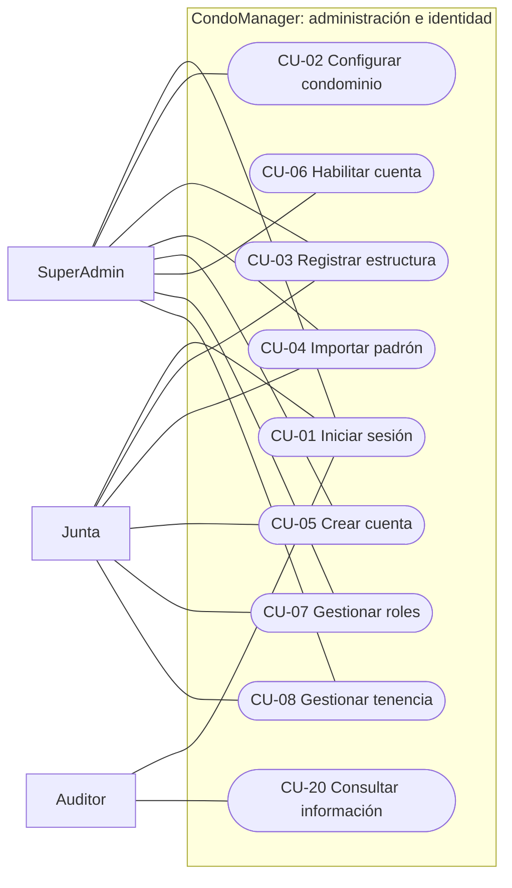

**Figura 2. Casos de uso administrativos.** La asociación de Junta con roles está limitada por las reglas de delegación. Solo SuperAdmin cambia el estado global de acceso.

### 7.3. Diagrama general: finanzas y reservas

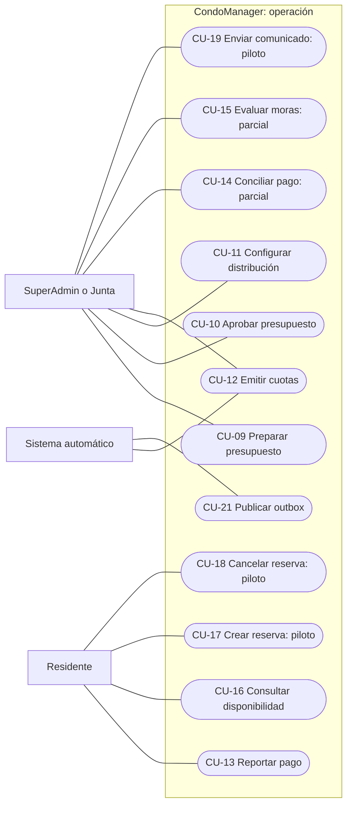

**Figura 3. Casos de uso operativos.** La administración también puede realizar operaciones de soporte sobre pagos y reservas autorizados, aunque se omiten esas asociaciones para conservar legibilidad.

### 7.4. Catálogo y relaciones

| Caso | Objetivo | Estado | Proceso |
|---|---|---|---|
| CU-01 | Iniciar sesión y seleccionar contexto | Persistente | PROC-05 |
| CU-02 | Crear y seleccionar condominio | Persistente | PROC-05 |
| CU-03 | Registrar edificio y departamento | Persistente | PROC-05 |
| CU-04 | Previsualizar y confirmar importación | Persistente | PROC-05 |
| CU-05 | Crear cuenta administrativa | Persistente | PROC-05 |
| CU-06 | Habilitar o deshabilitar acceso | Persistente | PROC-05 |
| CU-07 | Asignar, revocar o restaurar rol | Persistente | PROC-05 |
| CU-08 | Gestionar relación con departamento | Persistente | PROC-05 |
| CU-09 | Crear y editar presupuesto | Persistente | PROC-01 |
| CU-10 | Aprobar presupuesto | Persistente | PROC-01 |
| CU-11 | Configurar distribución | Persistente en API; UI parcial | PROC-01 |
| CU-12 | Emitir lote y aplicar crédito | Persistente; integración HTTP a verificar | PROC-01 |
| CU-13 | Reportar comprobante | Piloto; archivo pendiente | PROC-02 |
| CU-14 | Conciliar comprobante | Simulación HTTP | PROC-02 |
| CU-15 | Evaluar moras | Motor parcial; ruta sin datos reales | PROC-02 |
| CU-16 | Consultar áreas y franjas ocupadas | Catálogo y calendario piloto | PROC-04 |
| CU-17 | Reservar área común | SQL para solvencia; reserva en memoria | PROC-04 |
| CU-18 | Cancelar reserva | Memoria y regla temporal | PROC-04 |
| CU-19 | Enviar comunicado y consultar logs | Transporte y bitácora piloto | PROC-03 |
| CU-20 | Consultar información sin mutar | Implementado en ámbitos disponibles | Transversal |
| CU-21 | Publicar eventos confirmados | Relay implementado | PROC-01 / transversal |
| CU-22 | Gestionar egresos, tickets y balances | Especificado / futuro | PROC-06 a PROC-08 |

Las relaciones de inclusión del análisis son: CU-12 incluye cálculo de distribución, cierre de centavos y evaluación de crédito; CU-17 incluye autorización de unidad, evaluación de solvencia y comprobación de disponibilidad. Aplicar crédito positivo es una rama condicional; incluso con crédito cero el servicio persistente conserva un registro idempotente de aplicación.

### 7.5. CU-01: iniciar sesión y seleccionar contexto

**Actor principal:** cualquier usuario registrado. **Disparador:** envío del formulario de acceso. **Precondiciones:** identidad existente y cuenta activa; para usuarios no globales, al menos un contexto autorizado.

**Flujo principal:**

1. El usuario introduce correo y contraseña.
2. El cliente normaliza el correo y envía la solicitud.
3. El backend recupera la identidad SQL y verifica el hash.
4. Comprueba actividad y resuelve el contexto permitido.
5. Construye el perfil con rol y vínculos efectivos.
6. Emite un JWT con expiración y revisión de autorización.
7. La interfaz guarda la sesión y abre el portal correspondiente.

**Alternativas:** con varios contextos sin seleccionar se devuelve `CONTEXTO_REQUERIDO` y el usuario elige uno. Una contraseña incorrecta, cuenta inactiva o contexto inválido impide el acceso. Una caché local incompatible se descarta durante restauración.

**Postcondición:** sesión autenticada para un contexto concreto. **Evidencia:** `usuarios/service.py`, `core/security.py`, `AuthContext.tsx` y `/login`.

### 7.6. CU-02: configurar un condominio

**Actor:** SuperAdmin. **Precondición:** sesión global válida. **Objetivo:** registrar la raíz administrativa del padrón y su configuración financiera.

**Flujo:** introducir nombre, dirección, moneda, tipo de mora, importe o tasa, día de vencimiento y gracia; validar consistencia; crear UUID; guardar configuración y auditoría; mostrar el recurso y permitir su selección.

**Alternativas:** se rechazan valores fuera de rango y combinaciones incompatibles de mora fija y porcentual. Otros roles reciben denegación. **Postcondición:** condominio persistido. La entrega actual permite alta y consulta; no ofrece edición completa de configuraciones existentes.

### 7.7. CU-03: registrar la estructura inmobiliaria

**Actores:** SuperAdmin o Junta autorizada. **Precondición:** condominio existente. **Flujo:** crear edificio con nombre y pisos; seleccionar edificio; introducir número, piso y coeficiente del departamento; validar pertenencia, rango y unicidad; guardar unidad activa con saldo cero y estado inicial; auditar.

**Alternativas:** número repetido en el mismo edificio, piso superior al permitido, coeficiente inválido o escritura en otro contexto. Un número igual en otro edificio es válido. **Postcondición:** edificio o unidad disponible para operaciones posteriores y, una vez vinculada, para el portal del residente.

### 7.8. CU-04: importar un padrón CSV

**Actores:** SuperAdmin o Junta. **Precondiciones:** contexto válido y archivo conforme al límite de 2 MiB y 5000 filas.

**Flujo:** seleccionar archivo; analizar encabezados y filas; mostrar previsualización; informar errores sin crear registros; confirmar; revalidar frente al estado SQL; crear edificios y unidades válidos; devolver resultado individual; conservar auditoría de cambios efectivos.

**Alternativas:** filas mal formadas, datos contradictorios de edificio, duplicado incompatible o archivo excedido. Las filas existentes compatibles se reconocen sin sobrescribir datos financieros. **Postcondición:** importación parcial controlada y reintentable. La previsualización no reserva recursos ni sustituye la validación final.

### 7.9. CU-05: crear cuenta administrativa

**Actores:** SuperAdmin o Junta dentro de su alcance. **Flujo:** ingresar identidad, contacto y contraseña inicial; normalizar correo/documento; validar duplicados; generar hash; crear cuenta inactiva; crear rol contextual inicial de residente; auditar; mostrar datos públicos.

**Alternativas:** identidad ya registrada o formato inválido. Para una persona existente que necesita otro contexto se utiliza la asignación de rol, en lugar de duplicar la identidad. **Postcondición:** cuenta y asignación persistidas, sin acceso todavía y sin vínculos de tenencia inventados.

### 7.10. CU-06: habilitar o deshabilitar cuenta

**Actor:** SuperAdmin. **Precondición:** usuario identificado y contexto válido para la operación. **Flujo:** solicitar estado; comprobar autoridad; comparar con el estado vigente; actualizar cuando existe cambio; incrementar `auth_revision`; persistir auditoría; devolver estado.

**Alternativas:** Junta u otro rol no puede ejecutar el cambio. Repetir el mismo estado es un no-op. **Postcondición:** habilitación o bloqueo efectivo del acceso; una reactivación exige nuevo login y no vuelve válidos los tokens antiguos.

### 7.11. CU-07: gestionar roles contextuales

**Actores:** SuperAdmin o Junta con restricciones. **Flujo:** seleccionar usuario y contexto; consultar asignación; asignar, cambiar, revocar o restaurar; verificar autoridad y autoedición; conservar la fila; incrementar revisión en cambios efectivos; auditar.

**Alternativas:** Junta intenta conceder Junta, modificar asignación protegida o actuar fuera de su contexto. Se rechaza la escalada. La concesión de SuperAdmin queda fuera de esta API. **Postcondición:** asignación contextual vigente o revocada de forma durable y sesión anterior invalidada cuando corresponde.

### 7.12. CU-08: gestionar vínculos de tenencia

**Actores:** SuperAdmin o Junta. **Precondiciones:** usuario y unidad existentes; para asignar, rol contextual vigente y unidad activa.

**Flujo:** abrir vínculos; seleccionar UUID de unidad y relación; comprobar condominio; verificar titular requerido y conservación del último titular; crear o restaurar la relación; incrementar revisión; guardar auditoría; actualizar el portal en el siguiente login.

**Alternativas:** no hay titular previo para agregar inquilino/copropietario, se intenta retirar al último titular o la unidad es ajena. Restaurar conserva el identificador de la fila. **Postcondición:** relación persistente sin confundir propiedad con habilitación de acceso.

### 7.13. CU-09: preparar presupuesto mensual

**Actores:** SuperAdmin o Junta. **Precondiciones:** condominio existente y moneda compatible. **Flujo:** elegir periodo `AAAA-MM`; ingresar importe positivo y vencimiento del mismo mes; crear borrador o reemplazar datos del borrador; auditar; recuperar desde API.

**Alternativas:** periodo duplicado, fecha fuera del mes o intento de modificar aprobado. **Postcondición:** presupuesto `BORRADOR` persistido. La interfaz permite consulta y edición; sus importes todavía pasan por `Number` en este formulario, una brecha respecto de la política decimal.

### 7.14. CU-10: aprobar presupuesto

**Actores:** SuperAdmin o Junta. **Precondición:** borrador guardado. **Flujo:** revisar datos; confirmar aprobación; validar estado; fijar actor y fecha; cambiar a `APROBADO`; guardar auditoría; bloquear edición en la aplicación.

**Alternativas:** el recurso ya fue aprobado, no existe o pertenece a otro contexto. **Postcondición:** presupuesto elegible para emisión. La inmutabilidad se hace cumplir desde el servicio; no equivale a una prohibición universal de actualizar por SQL directo.

### 7.15. CU-11: configurar método de distribución

**Actores:** SuperAdmin o Junta. **Flujo:** escoger `POR_ALICUOTA` o `EQUITATIVA` mediante API; obtener unidades activas; validar padrón; comprobar suma exacta para alícuotas; guardar método único por condominio y auditoría.

**Alternativas:** padrón vacío, coeficiente inválido o suma distinta de `100.0000`. Una repetición idéntica conserva autor y fecha, aunque revalida los datos. **Postcondición:** método disponible para emisión. La interfaz actual muestra estimaciones por alícuota y no un editor completo de esta configuración.

### 7.16. CU-12: emitir lote mensual

**Actores:** SuperAdmin, Junta o worker interno. **Precondiciones:** condominio activo, presupuesto aprobado, padrón válido, método configurado y periodo no emitido.

**Flujo:** solicitar emisión con condominio y periodo; abrir transacción; bloquear raíz y unidades; verificar unicidad; recuperar presupuesto; calcular y cerrar centavos; crear cuotas; aplicar crédito previo; crear lote, auditoría y outbox; confirmar; devolver resumen.

**Alternativas:** `LOTE_YA_EMITIDO`, presupuesto no aprobado, distribución inválida o error de persistencia. La operación debe revertir todos los efectos ante fallo. **Postcondición:** lote y cuotas consistentes, o ausencia de efectos parciales. El posible solapamiento de transacciones entre autenticación SQL y emisión manual se registra como hallazgo pendiente de reproducción, no como fallo ejecutado en esta revisión.

### 7.17. CU-13: reportar comprobante

**Actor principal:** residente de la unidad autorizada; administración puede operar como soporte. **Flujo actual:** ingresar banco, operación, fecha e importe; seleccionar archivo si se utiliza el formulario; enviar datos; comprobar unidad activa y autorización; normalizar clave; registrar comprobante en memoria en revisión; devolver identificador.

**Alternativas:** reporte equivalente propio en revisión reutiliza el registro; uno ya aprobado o asociado a otra unidad produce conflicto. **Postcondición actual:** comprobante disponible durante la vida del proceso, sin modificar deuda SQL. **Cierre objetivo:** archivo realmente almacenado y registro durable con unicidad concurrente. La URL `blob:` del navegador no satisface ese cierre.

### 7.18. CU-14: conciliar comprobante

**Actores:** Junta o SuperAdmin. **Flujo de negocio objetivo:** consultar evidencia y movimiento bancario, decidir, aplicar importe a deudas reales, conservar excedente, recalcular solvencia y emitir evento tras commit.

**Flujo implementado:** localizar comprobante en memoria; validar contexto y unidad; construir una cuota sintética; aprobar o rechazar mediante servicio; modificar estructuras del proceso; devolver resultado.

**Alternativas:** rechazo sin motivo se deniega; el contrato acepta `OBSERVADO`, pero su tratamiento en el servicio no está diferenciado adecuadamente de la aprobación. **Postcondición actual:** respuesta de simulación; no se acredita reducción de deuda SQL ni rehabilitación durable.

### 7.19. CU-15: evaluar moras

**Actor objetivo:** sistema programado; administración como operación autorizada. **Regla:** revisar deuda vencida, gracia y comprobantes en revisión antes de aplicar recargo.

**Flujo del motor puro:** recorrer cuotas, omitir pagadas, verificar plazo, postergar por revisión y aplicar mora fija una vez según estado. **Situación HTTP:** recibe colecciones vacías y no evalúa cuotas SQL. **Situación UI:** el botón muestra un mensaje fijo sin invocar la ruta.

**Postcondición actual:** no hay evaluación durable de la cartera por este recorrido. La mora porcentual configurable y la recuperación programada requieren integración adicional.

### 7.20. CU-16: consultar áreas y disponibilidad

**Actores:** usuarios autenticados dentro de su contexto. **Flujo:** consultar catálogo activo; seleccionar área y fecha; validar contexto; listar inicio y fin de reservas confirmadas.

**Alternativas:** área inexistente o perteneciente a otro condominio. **Postcondición:** usuario conoce franjas ocupadas sin recibir identidad de residentes ajenos. Los datos actuales provienen del catálogo piloto y de reservas en memoria; consultar disponibilidad no bloquea ni garantiza un cupo posterior.

### 7.21. CU-17: crear reserva

**Actor principal:** residente autorizado. **Precondiciones:** unidad activa, área activa del contexto y sesión válida. **Flujo actual:** enviar fecha y horas; autorizar unidad; consultar deuda SQL; validar inicio anterior al fin; rechazar deuda positiva o estado `EN_MORA`; comprobar solapamiento en calendario del proceso; crear reserva `CONFIRMADA`; guardarla en memoria.

**Alternativas:** deuda (`403`), conflicto (`409`), horario inválido o área inactiva (`400`). **Postcondición actual:** franja ocupada en el proceso actual. El guardado SQL, la exclusión entre réplicas, el cargo financiero y la notificación real siguen pendientes.

### 7.22. CU-18: cancelar reserva

**Actores:** residente autorizado o administración. **Precondición:** reserva existente y confirmada. **Flujo:** solicitar cancelación; verificar unidad; derivar privilegio administrativo desde la sesión; aplicar al residente anticipación de al menos 24 horas; cambiar estado a `CANCELADA`; devolver resultado.

**Alternativas:** cancelación repetida, reserva no confirmada o plazo insuficiente. El booleano recibido del cliente no concede autoridad administrativa. **Postcondición actual:** liberación en memoria. Ajustes económicos y persistencia del historial forman parte del cierre pendiente.

### 7.23. CU-19: comunicar y consultar resultados

**Actores:** Junta/SuperAdmin para enviar; Auditor para consultar. **Flujo:** redactar título y mensaje; confirmar; generar solicitudes de plantilla; resolver destinatarios piloto; invocar transporte simulado; conservar logs en memoria; mostrar resultados e intentos.

**Alternativas:** fallos temporales calculan próxima fecha; fallos definitivos cambian estado; reenvío manual permite corregir destinatario. **Postcondición actual:** trazabilidad durante el proceso y éxito del mock, no evidencia de entrega externa.

### 7.24. CU-20: consultar información con perfil auditor

**Actor:** Auditor. **Precondición:** cuenta y rol contextual activos. **Flujo:** iniciar sesión; acceder al portal de Junta en modo lectura; consultar los recursos disponibles de estructura, presupuesto, comprobantes y logs; rechazar mutaciones desde backend.

**Postcondición:** información consultada sin modificar negocio. El enlace denominado Auditoría conduce al portal común; no existe una pantalla de consulta del ledger completo ni un módulo visual de auditoría inmutable.

### 7.25. CU-21: publicar eventos de outbox

**Actor:** worker interno. **Precondición:** evento de lote confirmado con `publicado_en` vacío. **Flujo:** bloquear una fila con `SKIP LOCKED`; serializar payload; publicar mediante `XADD`; marcar fecha; confirmar transacción SQL; continuar hasta el límite de la pasada.

**Alternativa:** caída tras publicar y antes del commit genera republicación con el mismo `event_id`. **Postcondición:** entrega al stream al menos una vez. El consumidor debe deduplicar; ese consumidor no se encontró implementado para notificaciones de cuotas.

### 7.26. CU-22: administración ampliada futura

**Actores previstos:** Junta, residentes y proveedores según proceso. **Objetivos:** registrar egresos sustentados, seguir contratos, tramitar incidencias y producir balances.

**Precondición objetivo:** datos de ingresos, gastos y operaciones persistentes e integrados. **Flujo general:** registrar, validar, asignar o aprobar, conservar historial y consolidar resultado. **Postcondición prevista:** información administrativa verificable. El caso agrupa capacidades futuras para mantener visible el alcance ampliado; no afirma la existencia de endpoints o pantallas de estos dominios.

## 8. Diagramas de actividad

### 8.1. Criterio de modelado

Los diagramas siguientes describen decisiones y recorridos. Se utiliza Mermaid para conservarlos como texto versionable y representarlos en visores Markdown compatibles. La notación representa el flujo de una actividad UML mediante nodos de inicio/fin, acciones y decisiones; no es un archivo UML intercambiable. Las ramas se etiquetan con sus condiciones.

Cada figura indica si corresponde al código actual o al diseño objetivo. Esta distinción evita representar tareas futuras como si ya fueran parte de la ejecución actual.

### 8.2. AD-01: autenticación y resolución contextual

**Alcance:** CU-01, comportamiento actual de aplicación.

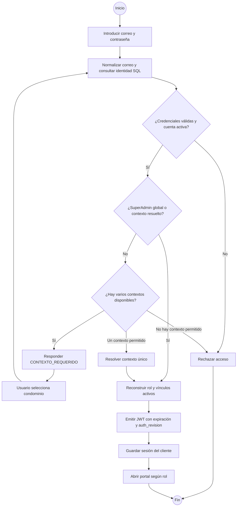

**Figura 4. Actividad de autenticación.** La restauración posterior consulta `/auth/me`; la firma del token se complementa con validación persistente de estado y revisión.

### 8.3. AD-02: importación de estructura

**Alcance:** CU-04, comportamiento actual con persistencia.

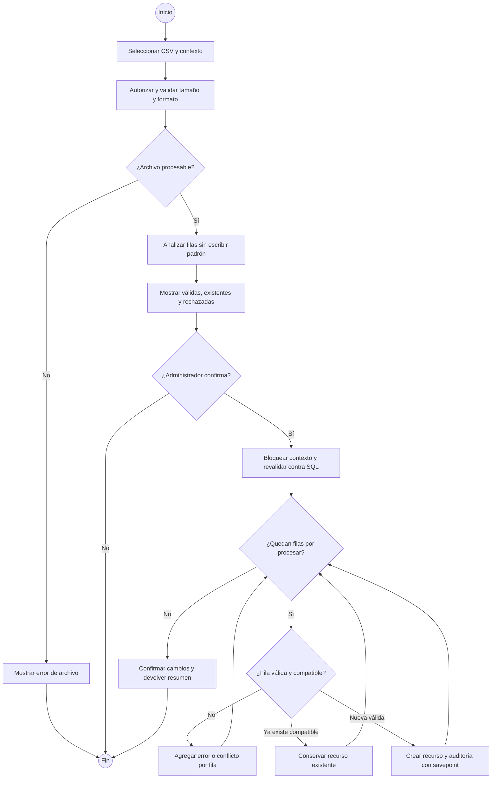

**Figura 5. Actividad de importación.** Las filas rechazadas se informan de forma individual. La confirmación revalida porque el estado pudo cambiar después de la previsualización.

### 8.4. AD-03: gestión de vínculos y protección del titular

**Alcance:** CU-08, reglas actuales.

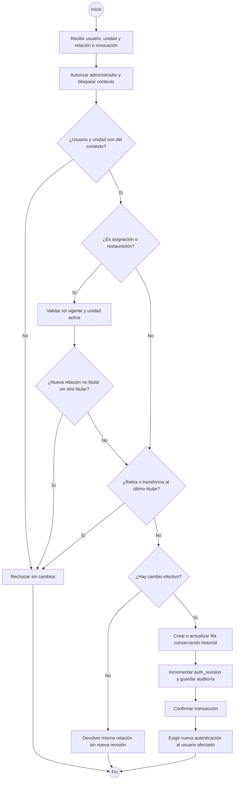

**Figura 6. Actividad de vínculos.** El modelo conserva titulares de tenencia aunque una cuenta esté deshabilitada; titularidad y permiso son dimensiones distintas.

### 8.5. AD-04: emisión persistente

**Alcance:** CU-12, algoritmo del servicio actual. El límite transaccional de la ruta manual requiere la verificación indicada en el capítulo 23.

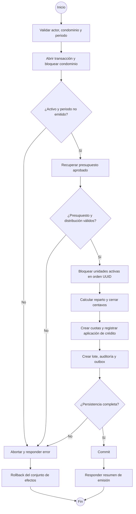

**Figura 7. Actividad de emisión.** La publicación a Redis ocurre en otro recorrido después del commit; no es una llamada al proveedor de correo dentro de la transacción.

### 8.6. AD-05: recepción y deduplicación de comprobante

**Alcance:** CU-13, recorrido actual del backend piloto.

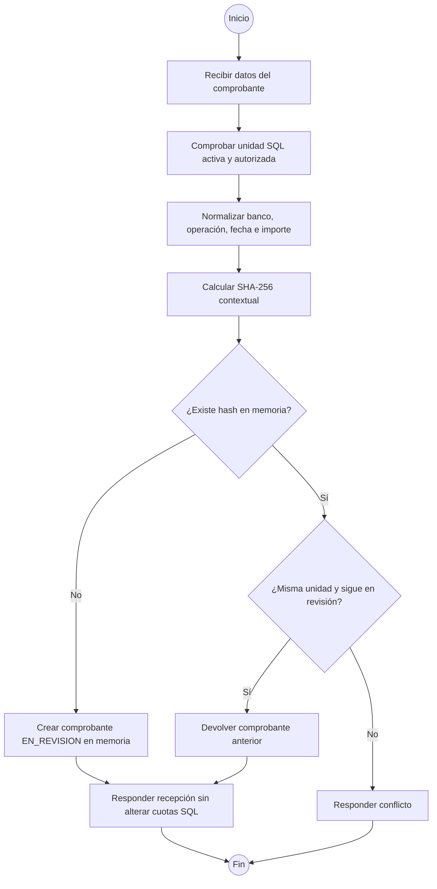

**Figura 8. Actividad de reporte piloto.** La carga durable del archivo y la protección de hash en PostgreSQL son parte del objetivo pendiente.

### 8.7. AD-06: conciliación financiera objetivo

**Alcance:** CU-14, **diseño TO-BE**. No describe la simulación de cuota utilizada actualmente por el router.

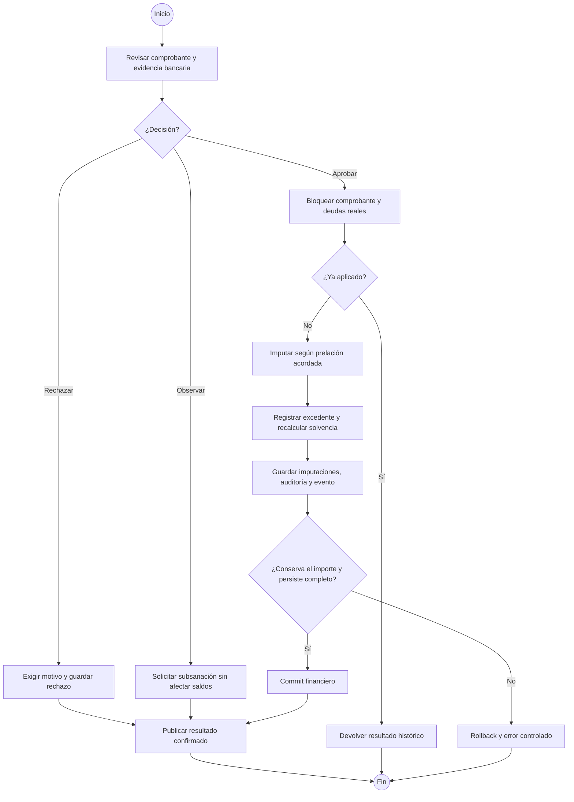

**Figura 9. Actividad objetivo de conciliación.** Las ramas rechazo y observación también requieren persistencia y publicación posterior al commit de su resultado; no implican aplicar dinero a cuotas.

### 8.8. AD-07: creación actual de reserva

**Alcance:** CU-17, consulta SQL y calendario en memoria.

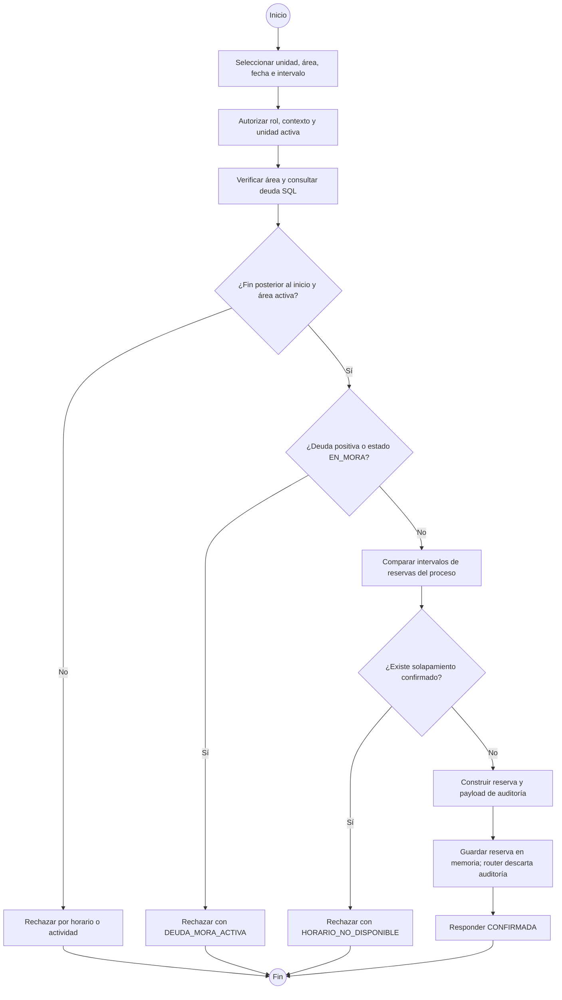

**Figura 10. Actividad actual de reserva.** No se representa un bloqueo SQL de área porque el recorrido actual no lo utiliza.

### 8.9. AD-08: cancelación actual

**Alcance:** CU-18.

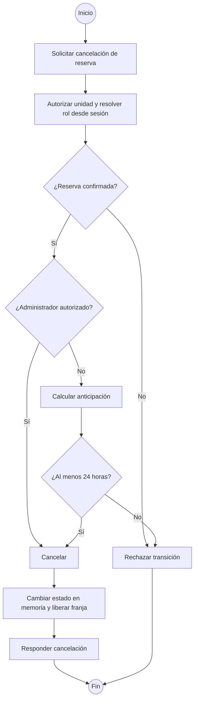

**Figura 11. Actividad de cancelación.** El cambio de estado conserva la reserva dentro del almacén de memoria; no ejecuta todavía un ajuste financiero persistente.

## 9. Modelado BPMN

### 9.1. Propósito y precisión de la notación

BPMN modela el proceso de negocio entre participantes y responsabilidades. Las actividades del capítulo anterior explican el algoritmo o flujo de un caso; los modelos de esta sección explican cómo colaboran personas, sistema y servicios externos.

Los gráficos Mermaid de esta sección son **vistas legibles de modelos BPMN**, acompañadas de las reglas necesarias para reconstruirlos en Bizagi u otra herramienta. Mermaid no implementa notación BPMN 2.0 nativa: sus rectángulos y círculos no deben confundirse con una exportación BPMN. El anexo B aporta además **un modelo BPMN 2.0 XML con información gráfica**, que puede guardarse como `.bpmn` e importarse para editar el proceso de aprobación.

Se aplican estas convenciones:

| Elemento BPMN | Representación en esta memoria | Significado |
|---|---|---|
| Pool | Subgráfico de participante externo o sistema | Límite de participante |
| Lane | Responsabilidad descrita en tabla o subgráfico interno | Área o actor dentro de un participante |
| Evento de inicio/fin | Círculo con etiqueta | Disparador o resultado final |
| Tarea de usuario | Acción identificada como humana | Interacción con una persona |
| Tarea de servicio | Acción identificada como automática | Operación del sistema |
| Compuerta XOR | Rombo con condición y salidas excluyentes | Se toma una sola ruta |
| Temporizador | Evento con etiqueta temporal | Inicio o espera por tiempo |
| Flujo de secuencia | Flecha continua dentro del pool | Orden de ejecución del proceso |
| Flujo de mensaje | Flecha discontinua entre pools | Comunicación entre participantes |
| Almacén de datos | Referencia explícita en la ficha | Persistencia consultada o modificada |

Los modelos TO-BE describen el objetivo. Las tareas todavía pendientes se señalan en la ficha y en la explicación. Un proceso documental no es un workflow ejecutable por la aplicación.

### 9.2. BPMN-01: preparación y emisión mensual de cuotas

**Proceso:** PROC-01. **Estado:** presupuesto, distribución, crédito y emisión persistentes; aviso al residente pendiente de consumidor y transporte reales.

| Aspecto | Definición |
|---|---|
| Pool principal | Administración CondoManager |
| Lanes | Junta, motor de cuotas, publicación de eventos |
| Pool externo | Residente |
| Inicio | Solicitud manual o temporizador del worker |
| Datos | Presupuesto, padrón activo, distribución, cuotas, aplicaciones, lote y outbox |
| Compuertas | Presupuesto aprobado; padrón válido; periodo no emitido |
| Fin correcto | Lote confirmado y evento pendiente/publicado |
| Excepciones | Presupuesto ausente, lote repetido, configuración inválida o fallo SQL |

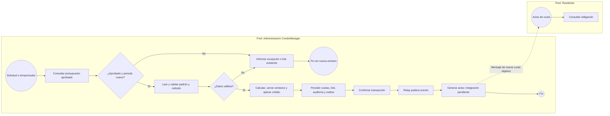

**Figura 12. BPMN de emisión.** Las tareas de cálculo, crédito, lote y outbox pertenecen a una unidad transaccional. El envío externo se representa después del commit. La recuperación actual del worker revisa el periodo corriente, no todo el historial faltante.

### 9.3. BPMN-02: reporte y conciliación de pago

**Proceso:** PROC-02. **Estado:** modelo objetivo; reporte y conciliación actuales son piloto.

| Aspecto | Definición |
|---|---|
| Pools | Residente y Administración CondoManager |
| Lanes internas | Recepción automática, tesorería y aplicación financiera |
| Inicio | Mensaje de comprobante reportado |
| Tareas humanas | Enviar evidencia, comparar con movimiento y decidir |
| Tareas de servicio | Validar, deduplicar, guardar, imputar y publicar resultado |
| Datos | Archivo, comprobante, cuotas, imputaciones, crédito y auditoría |
| Excepciones | Archivo inválido, duplicado incompatible, rechazo, observación y fallo de persistencia |

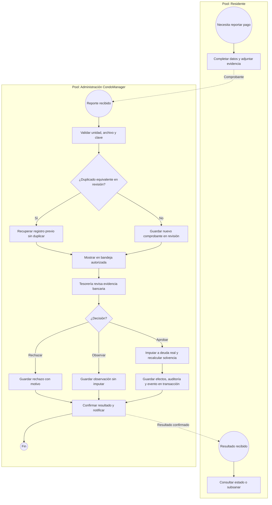

**Figura 13. BPMN objetivo de pagos.** La rama de duplicado representa únicamente reutilización legítima del reporte propio en revisión. Duplicados ya conciliados, reutilización en otra unidad o entradas inválidas terminan con rechazo controlado antes de continuar a revisión. Estos eventos de excepción se describen en la ficha para no saturar la figura.

### 9.4. BPMN-03: evaluación de morosidad

**Proceso:** PROC-02. **Estado:** TO-BE; existen reglas puras parciales, pero no el recorrido SQL programado completo.

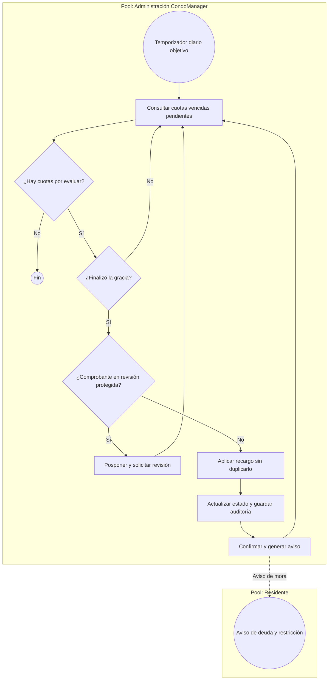

**Figura 14. BPMN objetivo de mora.** “Consultar” incluye avanzar sobre un conjunto finito de candidatos para no reevaluar indefinidamente la misma cuota. La programación horaria y la zona de corte deben unificarse porque las fuentes históricas no coinciden completamente.

### 9.5. BPMN-04: notificación y recuperación

**Proceso:** PROC-03. **Estado:** plantillas y cálculo de reintento disponibles; consumo, persistencia y entrega reales pendientes.

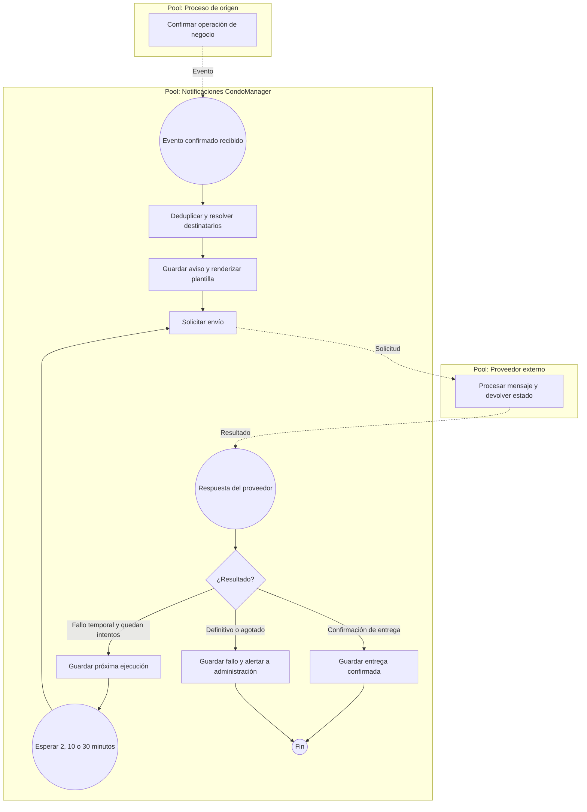

**Figura 15. BPMN objetivo de comunicaciones.** Una respuesta de aceptación sin confirmación de entrega requiere un estado intermedio y seguimiento; no debe etiquetarse automáticamente como entregada. El mock actual simplifica ese comportamiento.

### 9.6. BPMN-05: reserva y cancelación

**Proceso:** PROC-04. **Estado:** modelo objetivo de operación durable; validaciones parciales actuales.

| Aspecto | Definición |
|---|---|
| Pools | Residente y Administración CondoManager |
| Lanes internas | Atención de reservas y control financiero |
| Inicio | Solicitud de reserva |
| Compuertas | Autorización, solvencia, reglas del área y disponibilidad bajo exclusión |
| Datos | Área, unidad, cuotas, reserva, cargo y auditoría |
| Fin correcto | Reserva persistida; cancelación es otra instancia de proceso |
| Excepciones | Unidad ajena, mora, intervalo inválido, conflicto concurrente o plazo de cancelación |

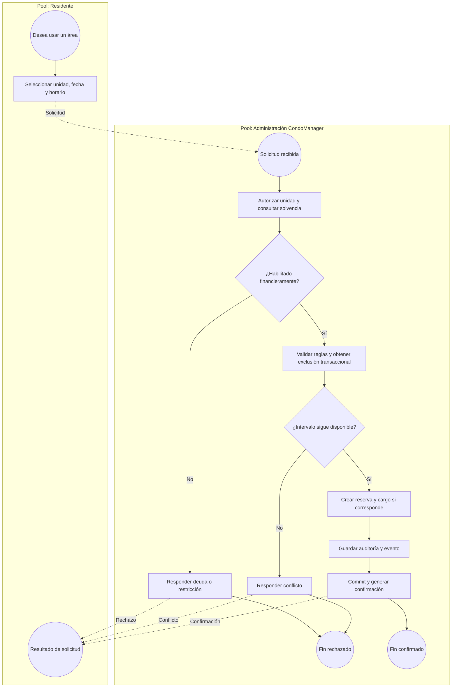

**Figura 16. BPMN objetivo de reserva.** Para dibujarlo en BPMN, las respuestas al residente son tareas de envío o eventos de mensaje. Los límites transaccionales se añaden como anotación; no constituyen por sí mismos la garantía SQL.

**Subproceso de cancelación objetivo:** mensaje de solicitud → autorizar → comprobar estado → compuerta “administrador o anticipación mínima cumplida” → persistir cancelación → emitir ajuste si corresponde → guardar auditoría/evento → commit → enviar resultado. La implementación actual cubre cambio de estado y plazo en memoria, no la persistencia ni el ajuste contable.

### 9.7. BPMN-06: alta y habilitación de usuario

**Proceso:** PROC-05. **Estado:** modelo alineado con la entrega actual de identidad, sin invitación por correo.

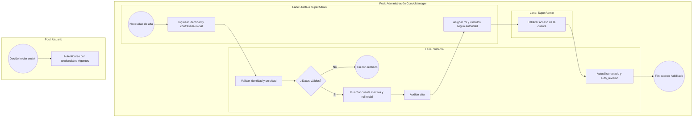

**Figura 17. BPMN de incorporación.** El alta, los vínculos y la activación son operaciones administrativas separadas, no una sola transacción. El usuario inicia después su propio proceso de login. No se representa una invitación automática porque está diferida.

### 9.8. BPMN-07: egresos y contratos

**Proceso:** PROC-06. **Estado:** especificado, no implementado como módulo operativo completo.

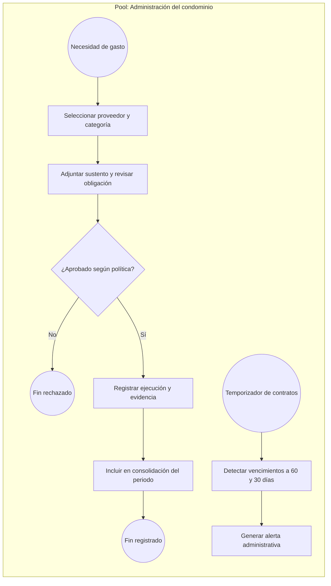

**Figura 18. BPMN futuro de egresos.** La política concreta de aprobación debe quedar acordada en el contrato del dominio antes de implementarse.

### 9.9. BPMN-08: atención de incidencias

**Proceso:** PROC-07. **Estado:** especificado; apoyo IA/RPA propuesto.

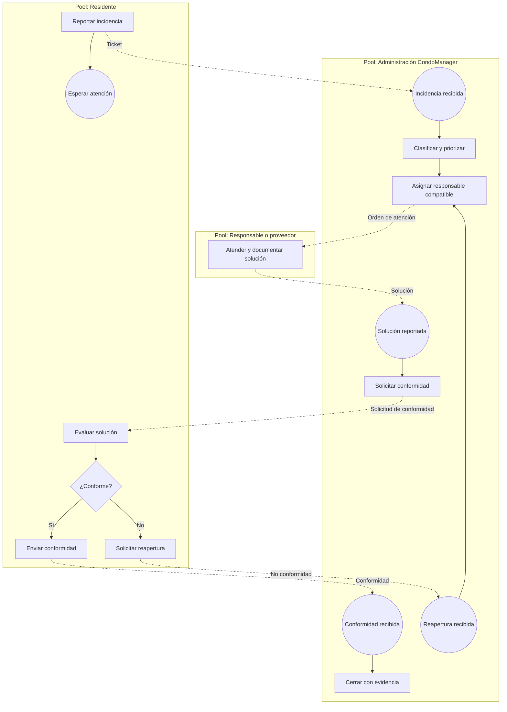

**Figura 19. BPMN futuro de incidencias.** La IA puede sugerir clasificación y prioridad, pero no sustituye las reglas críticas ni la conformidad de cierre. La espera representada es conceptual; el proceso completo deberá definir plazos y escalamiento.

### 9.10. BPMN-09: cierre y reportes

**Proceso:** PROC-08. **Estado:** especificado.

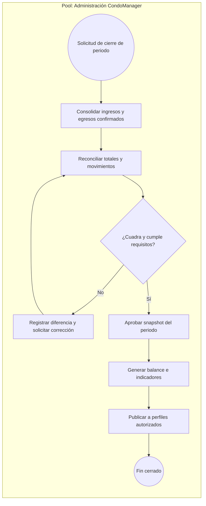

**Figura 20. BPMN futuro de cierre.** Las correcciones financieras deben conservar historial; no se modela el borrado de movimientos como mecanismo de ajuste.

### 9.11. Subproceso transversal de excepciones

El tratamiento común sigue: detectar fallo → clasificar → conservar contexto → decidir reintento o intervención → ejecutar recuperación → comprobar resultado → cerrar o escalar. Las acciones de negocio no deben duplicarse por un reintento técnico.

| Tipo de excepción | Tratamiento objetivo | Evidencia que debe conservarse |
|---|---|---|
| Validación | Rechazo controlado sin escritura parcial | Código y recurso afectado |
| Conflicto de unicidad | Recuperar histórico o devolver conflicto según contrato | Clave lógica y decisión |
| Fallo dentro de transacción | Rollback de todos los efectos | Identificador y diagnóstico técnico |
| Servicio externo temporal | Reintento durable con límite | Intentos, siguiente fecha y evento |
| Fallo definitivo | Escalamiento administrativo | Motivo, estado y acción requerida |
| Descuadre financiero | Detener y revisar | Importes esperados y observados |

### 9.12. Reglas para reconstrucción en Bizagi

1. Crear un pool por participante independiente y lanes por responsabilidad interna.
2. Mantener los flujos de secuencia dentro del mismo pool.
3. Conectar participantes mediante mensajes, sin atravesar pools con secuencias.
4. Modelar decisiones excluyentes con XOR y condiciones explícitas.
5. Utilizar tareas de usuario para revisión/aprobación y tareas de servicio para lógica automática.
6. Añadir almacenes y asociaciones de datos para presupuesto, cuotas, comprobantes y reservas.
7. Incluir eventos de fin diferenciados cuando el resultado de negocio lo requiera.
8. Marcar como TO-BE las tareas todavía pendientes de implementación.

La guía histórica de BPMN del repositorio es una fuente de requisitos, pero conserva invitación por correo y otros comportamientos superados. El modelo de incorporación de esta memoria utiliza la política reciente de alta inactiva y habilitación administrativa.

## 10. Arquitectura del sistema

### 10.1. Estilo arquitectónico

CondoManager implementa un **monolito modular**. Los dominios se separan en paquetes, pero los routers se montan en una aplicación FastAPI. El worker de cuotas es un proceso independiente que reutiliza código y base de datos del mismo proyecto.

La existencia de Redis y un worker no convierte automáticamente la solución en microservicios. La separación actual facilita organización por dominio y ejecución asíncrona sin introducir un despliegue independiente por cada módulo.

### 10.2. Vista de contexto

```mermaid
flowchart LR
    RE[Residentes] --> CM[CondoManager]
    AJ[Junta y SuperAdmin] --> CM
    AU[Auditor] --> CM
    CM --> DB[(Datos administrativos y financieros)]
    CM -. Integración prevista .-> CO[Proveedor de comunicaciones]
    CM -. Almacenamiento funcional pendiente .-> OB[Servicio de objetos]
    BA[Bancos y billeteras externas] -. Referencia revisada por tesorería .-> AJ
```

**Figura 21. Contexto de la solución.** Los pagos bancarios ocurren fuera de CondoManager. El sistema registra reportes y decisiones; no hay una pasarela o API bancaria integrada acreditada.

### 10.3. Vista de contenedores lógicos

```mermaid
flowchart TB
    US[Usuario en navegador]
    subgraph APP[Aplicación CondoManager]
        FE[Frontend Next.js y React]
        API[API FastAPI: nueve routers]
        WK[Worker de cuotas y relay]
        PG[(PostgreSQL)]
        RD[(Redis Streams)]
        MEM[(Almacenes del proceso: pagos, áreas, reservas y logs)]
        MI[MinIO: infraestructura configurada]
    end
    US --> FE
    FE -->|HTTP JSON y multipart CSV| API
    API -->|SQLAlchemy async| PG
    API --> MEM
    WK -->|Emisión y outbox| PG
    WK -->|XADD| RD
    API -. Subida de voucher pendiente .-> MI
    RD -. Consumidor de notificaciones pendiente .-> NT[Notificaciones futuras integradas]
```

**Figura 22. Contenedores y persistencia actual.** Los almacenes en memoria se muestran explícitamente porque condicionan reinicios y escalado horizontal.

### 10.4. Vista de capas del backend

```mermaid
flowchart TD
    CL[Cliente HTTP] --> RO[Routers y contratos Pydantic]
    RO --> SE[Servicios de aplicación y dominio]
    SE --> RE[Repositorios]
    RE --> OR[Modelos SQLAlchemy]
    OR --> PG[(PostgreSQL)]
    RO --> CO[Dependencias: identidad y autorización]
    SE --> AU[Auditoría y reglas decimales]
    SE -. Dominios piloto .-> ME[(Diccionarios en memoria)]
```

**Figura 23. Capas y excepciones del patrón.** Usuarios, estructura y subdominios financieros aplican la separación con mayor consistencia. Pagos, reservas y notificaciones mantienen orquestación y estado piloto en sus routers.

Las dependencias de FastAPI inyectan sesión, repositorios y usuario actual. El servicio decide reglas y resultados; el repositorio ejecuta consultas. Esta separación facilita dobles de prueba, pero una prueba con un repositorio fake no demuestra el comportamiento de PostgreSQL.

### 10.5. Vista de componentes financieros

```mermaid
flowchart LR
    EM[EmisionCuotasService] --> PR[Repositorio de presupuestos]
    EM --> DI[DistribucionService]
    DI --> DR[Repositorio de distribución y padrón]
    EM --> CE[cerrar_centavos]
    EM --> SF[SaldosFavorService]
    SF --> SR[Repositorio de saldo y aplicaciones]
    EM --> LO[LoteCuotas]
    EM --> OU[EventoLoteOutbox]
    EM --> AL[AuditoriaLogORM]
    PR --> PG[(Transacción PostgreSQL)]
    DR --> PG
    SR --> PG
    LO --> PG
    OU --> PG
    AL --> PG
```

**Figura 24. Componentes de la emisión.** La orquestación integra presupuesto, distribución y saldo en una transacción. La respuesta del lote conserva método, actor, total y fechas.

### 10.6. Vista de despliegue definido

```mermaid
flowchart TB
    BR[Navegador del usuario]
    subgraph DO[Host Docker Compose]
        FE[frontend: puerto 3000]
        BE[backend: puerto 8000]
        WK[cuotas-worker]
        RD[redis: host 6380 / interno 6379]
        MI[minio: API 9000 y consola 9001]
        RV[(Volumen redis_data)]
        MV[(Volumen minio_data)]
    end
    EX[(PostgreSQL externo configurado por DATABASE_URL)]
    BR --> FE
    BR -->|Fetch desde cliente| BE
    BE --> EX
    WK --> EX
    WK --> RD
    RD --> RV
    MI --> MV
```

**Figura 25. Despliegue local previsto por Compose.** La configuración base utiliza una conexión PostgreSQL externa. El override de CI añade PostgreSQL efímero. Esta figura describe la configuración del repositorio, no confirma un servidor remoto operativo.

### 10.7. Secuencia de una petición autenticada

```mermaid
sequenceDiagram
    actor U as Usuario
    participant F as Frontend
    participant A as API
    participant S as Seguridad
    participant P as PostgreSQL
    U->>F: Ejecutar operación
    F->>A: Solicitud con Bearer
    A->>S: Resolver usuario actual
    S->>S: Verificar firma y expiración
    S->>P: Consultar cuenta, revisión, rol y vínculos
    P-->>S: Perfil persistente
    alt Sesión vigente y alcance autorizado
        S-->>A: Actor reconstruido
        A->>P: Consultar o modificar recurso
        P-->>A: Resultado
        A-->>F: Respuesta
    else Revisión o acceso inválidos
        S-->>A: Rechazo de autenticación o autorización
        A-->>F: 401 o 403 según condición
    end
```

**Figura 26. Validación persistente de acceso.** Los claims del JWT no se aceptan como única fuente del rol vigente.

### 10.8. Secuencia de outbox y posible reentrega

```mermaid
sequenceDiagram
    participant E as Servicio de emisión
    participant P as PostgreSQL
    participant W as Relay
    participant R as Redis Stream
    E->>P: Cuotas, crédito, lote, auditoría y outbox
    E->>P: Commit de negocio
    W->>P: Seleccionar pendiente con lock y SKIP LOCKED
    P-->>W: Payload con event_id
    W->>R: XADD del evento
    R-->>W: Confirmación de publicación
    alt Commit de marca completado
        W->>P: Guardar publicado_en y commit
    else Caída antes del commit SQL
        Note over W,P: El outbox permanece pendiente
        W->>R: Republicar mismo event_id tras recuperación
    end
```

**Figura 27. Semántica al menos una vez.** La duplicación técnica de entrega es posible; el diseño del consumidor debe impedir duplicación lógica del efecto.

### 10.9. Decisiones y consecuencias

| Decisión | Beneficio | Consecuencia técnica |
|---|---|---|
| Monolito modular | Menor complejidad inicial y separación por dominio | La disciplina de dependencias sigue siendo necesaria |
| PostgreSQL | Integridad, precisión y bloqueos | Las garantías requieren pruebas contra motor real |
| AsyncSession | Integración no bloqueante con API | Debe existir un límite transaccional coherente |
| Roles contextuales | Una identidad puede operar en varios condominios | Toda petición debe resolver y comprobar contexto |
| Outbox | El evento nace junto al negocio confirmado | El relay puede reentregar y exige deduplicación |
| Decimal | Operación monetaria controlada | Todavía se necesita resolver residuos del reparto |
| Soft revoke | Conserva historial de acceso y tenencia | El perfil debe excluir relaciones inactivas |
| UI por features | Componentes más reutilizables | Persisten orquestadores y cliente API concentrados |

Los ADR de selección de stack y de precisión decimal respaldan estas decisiones. Las tecnologías mencionadas solo como opciones en especificaciones, como Celery o ARQ, no se incluyen como dependencias efectivamente utilizadas.

## 11. Tecnologías y organización del código

### 11.1. Stack del backend

| Tecnología | Declaración relevante | Responsabilidad |
|---|---|---|
| Python | `>=3.11`; Docker y CI principal usan 3.12 | Lenguaje del backend y scripts |
| FastAPI | `>=0.110.0` | API, inyección y documentación generada |
| Uvicorn | `>=0.28.0` | Servidor ASGI |
| Pydantic | `>=2.6.0` | Contratos y validación |
| Pydantic Settings | `>=2.2.0` | Configuración de entorno |
| SQLAlchemy asyncio | `>=2.0.28` | ORM y transacciones asíncronas |
| asyncpg | `>=0.29.0` | Driver PostgreSQL |
| Alembic | `>=1.13.1` | Evolución del esquema |
| Redis cliente | `>=5.0.3` | Publicación al stream |
| APScheduler | `>=3.10.4` | Programación del worker |
| python-multipart | `>=0.0.9` | Recepción de CSV multipart |
| python-jose / compatibilidad JWT | Dependencias declaradas; importación con preferencia por `jwt` disponible | Firma y validación de tokens |
| Passlib y bcrypt | Compatibilidad con formatos existentes | Verificación de hashes históricos |
| pytest, pytest-asyncio y pytest-bdd | Dependencias de desarrollo | Verificación de reglas y flujos |
| Ruff | `>=0.3.0` | Lint y formato |

`pyproject.toml` y `requirements.txt` no son idénticos: este último incluye `PyJWT` y herramientas adicionales utilizadas en ciertos entornos. El módulo de seguridad intenta importar `jwt` y utiliza `jose.jwt` como alternativa. El documento describe esa implementación, en lugar de atribuir todo el manejo de tokens a una única biblioteca por su presencia en el manifiesto.

### 11.2. Stack del frontend

| Tecnología | Versión/rango declarado | Responsabilidad |
|---|---|---|
| Next.js | `14.2.35` | App Router, compilación y servidor web |
| React / React DOM | `^18.3.1` | Interfaz y estado |
| TypeScript | `^5.6.3` | Tipado estático |
| Tailwind CSS | `^3.4.14` | Estilos utilitarios y tokens |
| Lucide React | `^0.453.0` | Iconografía |
| clsx y tailwind-merge | Rangos del manifiesto | Composición de estilos |
| ESLint / eslint-config-next | ESLint 8 y configuración Next 14.2.35 | Verificación del cliente |
| Node.js | 22 en Docker y CI | Entorno de build y ejecución |

Los rangos declarados pueden resolver versiones diferentes en el lockfile. No se utilizan actualmente TanStack Query, React Hook Form, Zod ni generadores de tipos OpenAPI, aunque figuren en propuestas de diseño.

### 11.3. Árbol funcional del repositorio

```text
CondoManager/
├── src/
│   ├── main.py
│   ├── core/                       Configuración, SQL, seguridad, errores y auditoría
│   ├── modules/
│   │   ├── usuarios/               Cuentas, roles, vínculos y catálogo autorizado
│   │   ├── condominios/
│   │   │   └── estructura/         Edificios, unidades e importación
│   │   ├── cuotas/
│   │   │   ├── presupuestos/
│   │   │   ├── distribucion/
│   │   │   ├── saldos/
│   │   │   ├── emision.py
│   │   │   └── worker.py
│   │   ├── pagos/
│   │   ├── reservas/
│   │   └── notificaciones/
│   ├── shared/                     Utilidades decimales
│   └── tests/                      Unitarias, integración y BDD
├── frontend/
│   ├── src/app/                    Páginas y layout
│   ├── src/components/             UI, permisos y componentes de dominio
│   ├── src/context/                Autenticación
│   ├── src/features/junta/
│   ├── src/features/residente/
│   ├── src/lib/                    HTTP, sesión, dinero y formato
│   └── tests/                      Pruebas Node del cliente y sesión
├── migrations/versions/            Revisiones Alembic
├── specs/                          Negocio, dominios, contratos y verificación
├── docs/                           Equipo, backlog, procesos y sprints
├── scripts/                        Bootstrap y verificaciones
├── .github/workflows/              Automatización de calidad y publicación
├── docker-compose.yml
├── docker-compose.ci.yml
├── Dockerfile
├── pyproject.toml
└── requirements.txt
```

### 11.4. Función de los artefactos de diseño

Las especificaciones documentan el objetivo y las decisiones; los modelos ORM documentan el mapeo utilizado por el código; las migraciones describen su evolución; el SQL capturado describe otra fotografía del esquema. Son fuentes complementarias, pero no intercambiables.

La memoria toma el código como evidencia de implementación y contrasta las otras fuentes para identificar alcance previsto y diferencias. El archivo de presentación anterior conserva referencias a una rama y rutas que ya no describen la API vigente.

## 12. Modelo de datos y migraciones

### 12.1. Organización del dominio

El modelo inmobiliario persistente sigue la jerarquía **condominio → edificio → departamento**. Usuarios es una identidad global que se relaciona con condominios mediante roles y con departamentos mediante tenencia. Las obligaciones financieras se asocian a la unidad y al periodo.

El esquema amplio SQL incluye 22 tablas de aplicación; el código representa 17 mediante ORM. La cadena de migraciones examinada crea 13 tablas de aplicación en una base nueva. La diferencia corresponde a dominios cuyo esquema o modelo existe, pero cuya migración e integración todavía no están completas. La tabla de control de Alembic no se cuenta como entidad de negocio.

### 12.2. Diagrama entidad–relación principal

```mermaid
erDiagram
    CONDOMINIOS ||--o{ EDIFICIOS : contiene
    EDIFICIOS ||--o{ DEPARTAMENTOS : agrupa
    USUARIOS ||--o{ USUARIO_ROLES : posee
    CONDOMINIOS ||--o{ USUARIO_ROLES : delimita
    USUARIOS ||--o{ USUARIO_DEPARTAMENTOS : mantiene
    DEPARTAMENTOS ||--o{ USUARIO_DEPARTAMENTOS : recibe
    CONDOMINIOS ||--o{ PRESUPUESTOS_MENSUALES : prepara
    CONDOMINIOS ||--o| CONFIGURACIONES_DISTRIBUCION : configura
    DEPARTAMENTOS ||--o{ CUOTAS_MANTENIMIENTO : adeuda
    CUOTAS_MANTENIMIENTO ||--o| APLICACIONES_SALDO_FAVOR : registra
    CONDOMINIOS ||--o{ LOTES_CUOTAS : emite
    PRESUPUESTOS_MENSUALES ||--o{ LOTES_CUOTAS : sustenta
    LOTES_CUOTAS ||--o| EVENTOS_LOTE_OUTBOX : publica
    CONDOMINIOS ||--o{ AUDITORIA_LOGS : conserva
    DEPARTAMENTOS ||--o{ COMPROBANTES_PAGO : reporta
    COMPROBANTES_PAGO ||--o{ IMPUTACIONES_PAGO : origina
    CUOTAS_MANTENIMIENTO ||--o{ IMPUTACIONES_PAGO : recibe
    CONDOMINIOS ||--o{ AREAS_COMUNES : dispone
    AREAS_COMUNES ||--o{ RESERVAS : recibe
    DEPARTAMENTOS ||--o{ RESERVAS : solicita
```

**Figura 28. Relaciones de los modelos ORM.** Comprobantes, imputaciones, áreas y reservas aparecen porque sus modelos existen, aunque los routers actuales no los utilicen para persistir. No se dibuja una FK lote–cuota: el modelo actual de cuota no incorpora `lote_id`; su asociación operativa se determina mediante unidad, condominio y periodo.

### 12.3. Diccionario de entidades: configuración e identidad

| Tabla | Campos relevantes | Integridad y uso |
|---|---|---|
| `condominios` | `id`, `nombre`, `direccion`, `moneda`, `regla_mora_tipo`, `monto_mora_fijo`, `tasa_mora_porcentaje`, `dia_vencimiento`, `dias_gracia`, `activo`, `creado_en` | Moneda PEN/USD, gracia 0–30 y vencimiento 1–28; consistencia de mora |
| `edificios` | `id`, `condominio_id`, `nombre_bloque`, `total_pisos` | FK al condominio; nombre único contextual y normalizado; pisos positivos |
| `departamentos` | `id`, `edificio_id`, `numero`, `piso`, `coeficiente_participacion`, `saldo_a_favor`, `estado_financiero`, `activo` | Número único por edificio; coeficiente positivo hasta 100; saldo no negativo |
| `usuarios` | `id`, `email`, `password_hash`, `nombre`, `apellido`, `telefono`, `documento_identidad`, `esta_activo`, `auth_revision`, `es_superadmin`, `creado_en` | Identidad global; índices normalizados; revisión mínima 1; inactiva por defecto |
| `usuario_roles` | `id`, `usuario_id`, `condominio_id`, `rol`, `es_activo` | Una asignación por usuario/condominio; revocación lógica |
| `usuario_departamentos` | `id`, `usuario_id`, `departamento_id`, `tipo_relacion`, `es_activo` | Una relación por usuario/unidad; catálogo de tenencia |

La protección del último titular está implementada en los servicios y en su coordinación de escrituras. El índice parcial de titulares mejora la consulta; no es por sí solo una restricción que garantice toda la regla de negocio.

### 12.4. Diccionario de entidades financieras

| Tabla | Campos relevantes | Integridad y uso |
|---|---|---|
| `presupuestos_mensuales` | `id`, `condominio_id`, `periodo`, `moneda`, `monto_total`, `fecha_vencimiento`, `estado`, `creado_por`, `creado_en`, `aprobado_por`, `aprobado_en`, `actualizado_en` | Único por contexto/periodo; importe positivo; aprobación coherente |
| `configuraciones_distribucion` | `id`, `condominio_id`, `metodo`, `actualizado_por`, `actualizado_en` | Una configuración por condominio; método equitativo o por alícuota |
| `cuotas_mantenimiento` | `id`, `departamento_id`, `periodo`, importes ordinario/extraordinario/mora/descuento/total/pagado, fechas y `estado` | Única por unidad/periodo; importes no negativos; pagado no supera exigible |
| `aplicaciones_saldo_favor` | `id`, `cuota_id`, `saldo_previo`, `monto_aplicado`, `monto_pendiente`, `saldo_restante`, estados y `creado_en` | Una por cuota; conserva saldo previo = aplicado + remanente |
| `lotes_cuotas` | `id`, `condominio_id`, `presupuesto_id`, `periodo`, `metodo`, `actor_id`, cantidades, monto y fechas | Único por contexto/periodo; cantidad y monto positivos |
| `eventos_lote_outbox` | `id`, `lote_id`, `payload`, `publicado_en` | Un evento por lote; JSONB; pendiente si no tiene fecha |

`monto_pendiente` en cuota es una propiedad calculada como exigible menos pagado, no una columna adicional del modelo actual. El diseño de compensaciones futuras debe mantener coherencia con las restricciones existentes.

### 12.5. Diccionario de entidades de soporte y piloto

| Tabla/modelo | Campos relevantes | Estado de integración |
|---|---|---|
| `auditoria_logs` | UUID, contexto, unidad opcional, timestamp, acción, motivo, resultado, actor, snapshots y hashes | Persistida en módulos avanzados |
| `comprobantes_pago` | Unidad, banco, operación, fecha, importe, voucher, hash, estado, motivo y datos de conciliación | Modelo ORM existente; ruta actual en memoria |
| `imputaciones_pago` | Comprobante, cuota, importe aplicado y fecha | Modelo existente; sin recorrido durable actual |
| `areas_comunes` | Contexto, nombre, descripción, aforo, costo y actividad | Modelo existente; catálogo HTTP piloto |
| `reservas` | Área, unidad, fecha, inicio, fin, costo, estado y creación | Modelo existente; calendario HTTP en memoria |
| `notificaciones_logs` | Definida en esquema amplio | Sin ORM/repositorio SQL actual del módulo |
| `proveedores`, `contratos_proveedor`, `gastos_egresos`, `tickets_incidencias` | Entidades de la visión ampliada | Esquema/documentación, sin circuito operativo completo |

El esquema SQL amplio y el ORM de reservas no coinciden en todos los campos: la captura SQL contempla información adicional, como solicitante y reglas de duración del área, que no está aplicada por el recorrido piloto. No se deben intercambiar sin comprobar compatibilidad.

### 12.6. Tipos y restricciones

- UUID para identidad de recursos y asociaciones.
- `NUMERIC(12,2)` para importes monetarios.
- `NUMERIC(7,4)` para coeficientes o tasas según entidad.
- Fecha para periodos de vencimiento y fecha/hora con zona para eventos relevantes.
- JSONB para snapshots y payloads de eventos.
- Unicidades para presupuesto, lote, cuota y asociaciones.
- `ON DELETE RESTRICT` en diversas relaciones financieras para preservar referencias.

Las restricciones de base proporcionan una segunda barrera de integridad. No sustituyen la autorización ni todas las reglas del servicio, como vencimiento dentro del mes o conservación de titulares en los recorridos administrativos.

### 12.7. Estados principales

```mermaid
stateDiagram-v2
    [*] --> BORRADOR: Crear presupuesto
    BORRADOR --> BORRADOR: Editar
    BORRADOR --> APROBADO: Aprobar
    APROBADO --> [*]: Disponible para emisión
```

**Figura 29. Estado del presupuesto.** No se implementa reapertura desde la aplicación.

| Entidad | Catálogo relevante | Observación |
|---|---|---|
| Cuota | `EMITIDA`, `PENDIENTE`, `PAGO_PARCIAL`, `PAGADA`, `VENCIDA`, `EN_MORA` | No todas las transiciones están integradas de forma durable |
| Departamento | `AL_DIA`, `OBSERVADO`, `EN_MORA` | El saldo y la deuda calculada también intervienen |
| Comprobante interno | `EN_REVISION`, `APROBADO`, `RECHAZADO`, `OBSERVADO` | El DTO de listado transforma aprobado a `CONCILIADO` |
| Reserva ORM | `SOLICITADA`, `CONFIRMADA`, `RECHAZADA`, `CANCELADA`, `COMPLETADA` | Piloto crea confirmadas y permite cancelación |
| Notificación DTO | Cola, entrega, reintento y fallo permanente | Debe distinguirse transporte mock y entrega real |

### 12.8. Evolución Alembic

| Revisión | Fecha | Cambio |
|---|---|---|
| `20261008_0001` | 08/10/2026 | Condominios y auditoría |
| `20261008_0002` | 08/10/2026 | Presupuestos mensuales |
| `20261014_0003` | 14/10/2026 | Configuración de distribución |
| `20261014_0004` | 14/10/2026 | Aplicaciones de saldo a favor |
| `20261018_0005` | 18/10/2026 | Estructura inmobiliaria y adopción de tablas previas |
| `20261019_0006` | 19/10/2026 | Cuotas, lotes, outbox y referencias financieras |
| `20261020_0007` | 20/10/2026 | Identidad persistente, revisión y concesión global |
| `20261020_0008` | 20/10/2026 | Roles revocables |
| `20261020_0009` | 20/10/2026 | Índice de titulares activos |

Las revisiones de adopción validan determinadas tablas existentes y conservan su procedencia para controlar el downgrade. La reversión de roles revocables se bloquea si haría perder la representación de una revocación y rehabilitaría acceso al volver a una versión anterior.

### 12.9. Diferencias entre fuentes de esquema

`condomanager_schema.sql` registra una fotografía correspondiente a revisión `0006`, mientras el código requiere cambios hasta `0009`. Esto acredita desalineación del archivo, no que la base remota siga en esa revisión.

El DDL de referencia en `specs` también conserva una organización antigua de departamentos en algunas secciones. Además, Alembic no registra todos los modelos de pagos y reservas dentro de su metadata. Por ello:

1. El esquema debe evolucionar mediante un recorrido acordado, con baseline explícito si se adopta una instalación previa.
2. Importar un dump y después ejecutar todas las migraciones no es una secuencia universalmente válida.
3. Una autogeneración debe revisarse para evitar interpretaciones erróneas de tablas no registradas.
4. Los checks de drift actuales son diagnósticos, no prueba de alineación de todo el producto.

## 13. Implementación del backend

### 13.1. Entrada y composición de la API

`src/main.py` crea FastAPI, registra handlers de errores, configura CORS y monta nueve routers bajo `/api/v1`. Las rutas `/health` y `/api/v1/health` devuelven una respuesta constante con nombre del servicio y metodología.

La aplicación Python no ejecuta por sí misma migraciones ni arranca el worker mediante un evento `lifespan`. En contenedor, el comando del Dockerfile aplica Alembic antes de Uvicorn. Son responsabilidades de arranque diferentes.

El healthcheck verifica que la API responde; no comprueba PostgreSQL, Redis ni almacenamiento. Una respuesta de salud satisfactoria no certifica preparación integral de todas las dependencias.

### 13.2. Configuración y sesiones

`Settings` centraliza variables de base, Redis, JWT, piloto y servidor. `create_async_engine` usa `pool_pre_ping=True` y `hide_parameters=True`. La fábrica de sesiones evita expiración al commit y autoflush automático.

La dependencia SQL entrega una sesión, confirma al finalizar sin error y revierte ante excepción. Usuarios realiza además commits explícitos desde su repositorio; emisión declara ser propietaria del límite de transacción y saldos utiliza una transacción externa con savepoints. La convivencia de estas estrategias es una consideración técnica importante para los recorridos integrados.

### 13.3. Usuarios, roles y vínculos

El servicio de usuarios agrupa autenticación, altas, consulta, estado, roles y tenencia. Normaliza identidad, comprueba autoridad y utiliza bloqueos en operaciones críticas para revalidar al actor después de esperar.

Los cambios efectivos conservan historial y aumentan revisión. Las operaciones idénticas evitan auditoría redundante. La revocación de un rol no elimina la identidad; revocar tenencia no elimina pagos o cuotas de la unidad. Esta separación reduce efectos secundarios incorrectos.

### 13.4. Condominios y estructura

El módulo de condominios implementa creación y consulta administrativa. El submódulo `estructura` agrega servicios, repositorios y validación de archivos. La importación admite encabezados reordenados, separadores coma/punto y coma, BOM y campos entrecomillados.

El control de unicidad se realiza dentro del contexto correcto. La combinación edificio–número identifica unicidad de departamento, mientras el UUID identifica el recurso entre operaciones. El servicio evita que un reintento sobrescriba saldos o reactive automáticamente una unidad.

### 13.5. Presupuestos y distribución

Presupuestos controla borrador, edición, aprobación e inmutabilidad de aplicación. Distribución valida configuración y padrón activo. Para alícuota exige suma exacta y coeficientes válidos; para reparto equitativo exige unidades disponibles.

El cálculo puro redondea por unidad. El ajuste del total del lote corresponde a emisión. Esta división de responsabilidad permite probar las fórmulas y el cierre de manera independiente.

### 13.6. Emisión y crédito

`EmisionCuotasService` bloquea la raíz, busca el presupuesto aprobado, bloquea departamentos en orden UUID y consume los servicios de distribución y saldos. Al final registra lote y evento junto a la auditoría.

La aplicación de crédito conserva un resultado histórico único por cuota, incluso si el importe aplicado es cero. Un crédito agregado después no se vuelve a consumir al reintentar esa aplicación inicial. Así se distingue repetir una operación de ejecutar una nueva operación financiera.

Permanece un simulador legado, `CuotasService.emitir_lote_en_memoria`, utilizado por pruebas y scripts piloto. Su contrato acepta importes que el endpoint persistente actual ya no recibe.

### 13.7. Pagos y mora

`PagosService` implementa normalización, hash, detección de reutilización y cálculo de aplicación sobre colecciones recibidas. El router actual mantiene el diccionario de comprobantes y construye una cuota ficticia al conciliar.

`MotorMorasService` contiene lógica de recargo fijo, periodo de gracia y postergación por revisión. La ruta `/moras/evaluar` le entrega listas vacías. La descripción de estas clases como motor contable no debe interpretarse como integración persistente de cartera.

### 13.8. Reservas

El servicio calcula solapamiento con intervalos semiabiertos: `[inicio, fin)`. Dos reservas adyacentes son compatibles. La creación rechaza fin anterior o igual al inicio, área inactiva y deuda positiva o estado `EN_MORA`.

El router obtiene la unidad de PostgreSQL y conserva la reserva en memoria. La auditoría retornada por el servicio se descarta; la presencia del payload en código no equivale a un registro SQL de la operación.

La consulta de deuda suma obligaciones con vencimiento anterior a la fecha UTC actual y pendiente positivo. No incorpora por sí misma la gracia configurada. Por tanto, puede bloquear por cuota vencida antes de que el motor de mora la marque como `EN_MORA`. Esta diferencia exige una definición contractual común de solvencia.

### 13.9. Notificaciones

El catálogo contiene nueve plantillas: emisión, recordatorio previo, recepción de pago, conciliación, rechazo, mora, reserva confirmada, reserva cancelada y comunicado general.

El servicio clasifica códigos definitivos, calcula siguiente intento y permite reenvío manual. El transporte predeterminado siempre informa éxito simulado. No aparece un repositorio SQL del módulo, un ejecutor de reintentos ni integración del consumidor con Redis Streams.

### 13.10. Manejo de errores

Los errores propios `APIError` utilizan `error_code`, `mensaje` y detalles opcionales. Otros routers lanzan `HTTPException` con contenido bajo `detail`. La validación también contiene adaptaciones por ruta.

La interfaz debe tolerar esos formatos actuales. Unificar el contrato de error permitirá conservar códigos y detalles de campo, en lugar de depender de búsquedas de texto para decidir qué ocurrió.

## 14. Implementación del frontend

### 14.1. Páginas y navegación

| Ruta | Función |
|---|---|
| `/` | Bienvenida o redirección al portal según sesión |
| `/login` | Credenciales, contexto y accesos demo |
| `/junta` | Portal de administración y auditor de lectura |
| `/residente` | Reservas, reporte de comprobante y cuenta |
| `/residente?dpto=<UUID>` | Selección de unidad contrastada con autorización |

Existen estados de carga, error y no encontrado. Las secciones internas de Junta y Residente dependen de estado React; no son subrutas independientes, por lo que recargar o compartir la URL no conserva necesariamente la sección.

### 14.2. Portal de Junta

La navegación ofrece resumen, configuración para SuperAdmin, estructura, usuarios, presupuesto, distribución/emisión, conciliación, moras y comunicados. Auditor no recibe administración de usuarios ni acciones de escritura.

| Componente | Responsabilidad |
|---|---|
| `JuntaPortal` | Carga, contexto y coordinación de acciones |
| `ConfiguracionCondominio` | Alta y selección de condominio |
| `EstructuraCondominio` | Edificios, unidades, CSV y estado |
| `UsuariosSection` | Alta y listado paginado |
| `RolUsuarioEditor` | Asignación y revocación contextual |
| `VinculosUsuarioSection` | Gestión de tenencia |
| `PresupuestoMensual` | Consulta, borrador y aprobación |
| `CuotasSection` / `AsistenteEmision` | Estimación y solicitud de lote |
| `ConciliacionSection` | Tabla y decisiones sobre comprobantes |
| `MorasSection` | Información y botón actualmente simulado |
| `ComunicadosSection` | Redacción e historial de logs |

La interfaz de conciliación todavía no ofrece visor de voucher, filtros completos o detalle contable. La emisión muestra una estimación y un resumen de resultado, no un historial de cuotas persistidas.

### 14.3. Portal del residente

La selección de departamento utiliza UUID y contrasta vínculos activos con el catálogo SQL. Esto distingue unidades con el mismo número en distintos edificios.

| Sección | Funcionalidad real | Límite |
|---|---|---|
| Reservas | Áreas, horarios ocupados, solicitud, listado y cancelación | Backend piloto y sin calendario gráfico |
| Reportar comprobante | Datos del pago, selección local de archivo y listado | Sin upload persistente |
| Estado de cuenta | Saldo y estado de unidad desde API | Cuota base y periodo referenciales estáticos |

`ResumenCuenta` utiliza importes referenciales `141.78` o `154.29` según coeficiente y un periodo fijo `2026-10`. Esos valores no deben interpretarse como la cuota definitiva de cada unidad emitida por el backend. No existe todavía una bandeja de avisos del residente.

### 14.4. Estado y cliente HTTP

`AuthContext` mantiene usuario, token, unidad activa y preparación de sesión. Los datos de negocio se cargan mediante hooks y `fetch`, sin una librería especializada de caché.

El cliente central `lib/api.ts` añade Bearer, envía JSON o multipart y emite un evento de sesión revocada ante `401`. Junta utiliza carga conjunta con `Promise.all`; Residente maneja resultados separados mediante `Promise.allSettled` y permite recuperación por recurso.

No existe un canal WebSocket, SSE o polling general. Los mensajes de seguimiento “en tiempo real” de algunas vistas no acreditan actualización continua de los datos.

### 14.5. Tipos y contratos

Las interfaces TypeScript representan usuarios, roles, vínculos, condominios, estructura, presupuestos, pagos, reservas y notificaciones. Se escriben manualmente; no se generan desde OpenAPI. Existe un adaptador para nombres históricos como `coeficiente` frente a `coeficiente_participacion`.

Algunas funciones lanzan excepciones y otras devuelven `{ ok, error }`. Ciertos adaptadores pierden códigos y detalles estructurados. Esta heterogeneidad dificulta asociar errores del backend a campos de formulario.

### 14.6. Componentes reutilizables y accesibilidad

Se dispone de botones, campos, controles monetarios, dropzone, diálogos, tabs, tarjetas, alertas, badges, spinners y estados vacíos. Los componentes de dominio presentan estados de cuota, comprobante, solvencia y reserva.

Hay idioma español, enlace para saltar al contenido, foco visible, etiquetas asociadas, descripciones, estados anunciables, encabezados de tabla y reglas de reducción de movimiento.

Persisten brechas: tabs no vinculadas completamente con paneles, referencias ARIA de ayuda en el dropzone, objetivos táctiles pequeños y ausencia de foco uniforme al primer error. No se presenta una conformidad WCAG certificada.

### 14.7. Responsive

Residente utiliza barra inferior en móvil y tabs en pantallas mayores. Junta muestra navegación lateral en escritorio y una fila horizontal desplazable en tamaños inferiores. Formularios y tarjetas usan grids adaptables; las tablas anchas conservan desplazamiento horizontal.

La tabla administrativa no se transforma en tarjetas móviles y la cabecera oculta parte de la identidad en pantallas pequeñas. También conserva el nombre fijo Villa Bonita 3 aunque se seleccione otro contexto.

### 14.8. Archivo de voucher y modo demo

El formulario crea una URL con `URL.createObjectURL(file)` y envía esa cadena; después la revoca. Una URL `blob:` está ligada al navegador y no constituye almacenamiento accesible para otro usuario. La selección local de archivo está construida, pero la carga durable sigue pendiente.

El modo demo utiliza login real de cuentas predefinidas. Está habilitado salvo que `NEXT_PUBLIC_DEMO_MODE` sea exactamente `false` y puede intentar acceso automático como Junta cuando no hay sesión. Las credenciales de demostración están incluidas en el código cliente. Esto se documenta como comportamiento actual; no se reproducen sus contraseñas en esta memoria.

`frontend/DESIGN.md` contiene una propuesta de evolución. Sus referencias a bibliotecas futuras, visor de conciliación, auditoría visual y otras mejoras no son evidencia de que ya estén construidas.

## 15. Autenticación, autorización y auditoría

### 15.1. Contraseñas

Los hashes nuevos se generan mediante PBKDF2-HMAC-SHA256 con salt aleatorio y 100000 iteraciones. La verificación acepta también formatos PBKDF2 y bcrypt existentes. El formato propio utiliza comparación constante del derivado.

El hash de contraseña es una derivación no reversible; no debe describirse como “cifrado que luego se descifra”. La API devuelve datos públicos de cuenta y no el hash.

### 15.2. JWT y duración

La sesión incorpora identidad, rol, contexto, relaciones, expiración, emisión, versión de contrato y `auth_revision`. El módulo de seguridad fija por defecto 24 horas, coherentes con los 86400 segundos reportados en login.

`Settings.ACCESS_TOKEN_EXPIRE_MINUTES` conserva un valor distinto que no gobierna ese cálculo actual. Esta diferencia de configuración debe armonizarse. No se encontró refresh token, registro de sesiones por dispositivo ni revocación individual de un token desde logout.

### 15.3. Validación persistente

En cada petición protegida se comprueba:

1. Firma y expiración del token.
2. Versión y forma del contrato de sesión.
3. Existencia y actividad de la cuenta.
4. Coincidencia de `auth_revision`.
5. Rol contextual vigente.
6. Vínculos efectivos reconstruidos desde SQL.
7. Permiso sobre el recurso solicitado.

Un token firmado correctamente puede ser rechazado si el permiso ya no existe. El perfil actualizado sustituye los datos contextuales del token antes de continuar.

### 15.4. Revocación

Un cambio real de estado, rol o vínculo aumenta la revisión global del usuario y hace que la siguiente petición con una revisión anterior se rechace. Restaurar el permiso no disminuye la revisión ni revive tokens antiguos.

La revisión global simplifica revocación, pero puede invalidar sesiones de otros contextos de la misma identidad. La desactivación de una unidad también reduce vínculos efectivos al reconstruir el perfil, aunque esa operación no incremente necesariamente la revisión del usuario.

### 15.5. Autorización por recurso

El control de permisos no depende de ocultar botones. `RoleGuard` mejora la experiencia, mientras que el backend comprueba contexto y unidad. Un residente no puede sustituir el UUID en la URL o el payload para acceder a otra unidad.

Disponibilidad devuelve horas ocupadas sin divulgar el departamento ajeno. Los listados privados de comprobantes y reservas filtran por las unidades permitidas al residente. Auditor tiene acceso de lectura a recursos disponibles de su contexto.

### 15.6. Sesión del cliente

La interfaz utiliza `localStorage` para `condo_token`, `condo_user`, `condo_depto` y `condo_active_id`. Restaurar consulta `/auth/me`; la caché no concede permiso por sí misma. El logout limpia el estado local.

No hay cookie HttpOnly de sesión, renovación automática ni sincronización completa entre pestañas. El JWT está firmado, no cifrado, por lo que su contenido no debe tratarse como secreto protegido frente al propio cliente.

### 15.7. Auditoría implementada

El payload conserva siete campos mínimos: unidad, fecha/hora, acción, motivo, resultado, estado anterior y estado posterior. Se añaden condominio, actor y hashes encadenados.

```text
hash_actual = SHA256(
    contexto + unidad + timestamp + acción + motivo + resultado
    + snapshot_anterior + snapshot_posterior + hash_previo
)
```

La expresión resume la serialización ordenada del código; no es una firma digital con clave privada. Los módulos persistentes guardan el evento junto a sus cambios de negocio en las operaciones correspondientes.

### 15.8. Límites de la garantía de auditoría

- El cálculo del hash actual excluye `actor_id` y `actor_tipo`.
- No se encontró una política append-only completa mediante permisos, triggers o verificación externa.
- Los servicios piloto pueden crear payloads que el router no persiste.
- La serialización de la cadena no está unificada entre todas las escrituras; presupuesto no bloquea la raíz de la misma manera que otros módulos.
- No todos los intentos fallidos generan auditoría persistente.

Por ello, se documenta **auditoría con snapshots y encadenamiento hash parcial**, con un objetivo de inmutabilidad más amplio aún por completar.

### 15.9. RLS y configuración de acceso

El SQL amplio habilita RLS en varias tablas, pero no presenta políticas operativas de aislamiento ni `FORCE ROW LEVEL SECURITY`. El backend no establece un contexto RLS por petición en los archivos revisados.

El aislamiento observado se implementa principalmente en servicios y dependencias. No se afirma que PostgreSQL ya aplique una política multi-condominio completa a cualquier rol de conexión.

La aplicación utiliza CORS abierto en el corte actual. Las variables de configuración contienen valores de desarrollo; esta memoria documenta los nombres y responsabilidades sin publicar secretos de un entorno real ni inspeccionar `.env`.

## 16. Reglas financieras y ejemplos

### 16.1. Precisión decimal

Los cálculos financieros del backend utilizan `Decimal` creado desde cadenas, con redondeo `ROUND_HALF_UP`. PostgreSQL conserva importes con dos decimales y coeficientes con cuatro.

`ROUND_HALF_UP` redondea los empates alejándose de cero; no debe confundirse con redondeo a par, a veces denominado bancario. Usar Decimal evita errores binarios, pero no elimina residuos al repartir un total entre varias unidades.

### 16.2. Distribución por alícuota

```text
cuota_bruta_i = presupuesto_total × coeficiente_i / 100
sumatoria_coeficientes_activos = 100.0000
```

Para un presupuesto `20850.00` y un coeficiente `0.6800`:

```text
20850.00 × 0.6800 / 100 = 141.780000
cuota redondeada = 141.78
```

Para coeficiente `0.7400`, el resultado es `154.29`. Los coeficientes se interpretan como porcentajes, de ahí la división entre 100.

El sistema rechaza sumas `99.9999` o `100.0001`; no utiliza una tolerancia aproximada de coma flotante. La suma se realiza sobre unidades activas del condominio, no solo sobre el edificio visible en una pantalla.

### 16.3. Distribución equitativa y cierre

Un total `100.00` entre tres unidades produce cuotas inicialmente redondeadas de `33.33`, cuya suma es `99.99`. Emisión agrega el centavo residual de forma determinista:

| Unidad en orden determinista | Cálculo redondeado | Ajuste | Cuota definitiva |
|---|---:|---:|---:|
| A | 33.33 | +0.01 | 33.34 |
| B | 33.33 | 0.00 | 33.33 |
| C | 33.33 | 0.00 | 33.33 |
| **Total** | **99.99** | **+0.01** | **100.00** |

El código ordena por importe descendente y UUID, y distribuye pasos de `0.01` positivos o negativos. La propiedad relevante es:

```text
sumatoria(cuotas_brutas_definitivas) = presupuesto_aprobado
```

### 16.4. Aplicación de saldo a favor

```text
aplicado = mínimo(cuota_bruta, saldo_previo)
pendiente = cuota_bruta - aplicado
saldo_restante = saldo_previo - aplicado
monto_pagado_inicial = aplicado
monto_descuento = 0.00
```

| Cuota bruta | Saldo previo | Aplicado | Pendiente | Saldo restante | Estado posterior |
|---:|---:|---:|---:|---:|---|
| 154.29 | 200.00 | 154.29 | 0.00 | 45.71 | PAGADA |
| 154.29 | 100.00 | 100.00 | 54.29 | 0.00 | PENDIENTE |
| 154.29 | 0.00 | 0.00 | 154.29 | 0.00 | PENDIENTE |

La cuota bruta sigue siendo `154.29` en los tres escenarios. El crédito reduce lo pendiente mediante pago. Esta decisión permite conservar la igualdad entre presupuesto y total facturado.

### 16.5. Idempotencia de crédito y lote

La aplicación guarda una evidencia única por cuota. Si se repite, devuelve el histórico y no consume otro crédito. La emisión utiliza una unicidad por condominio/periodo y responde conflicto ante un lote ya existente.

Estas garantías son específicas de cada operación. No se deben extrapolar al comprobante en memoria ni a la conciliación piloto, cuya durabilidad todavía no está integrada.

### 16.6. Clave de comprobante

```text
SHA256(condominio_id | banco_normalizado | operación_normalizada | fecha_ISO | monto_2_decimales)
```

El condominio delimita la clave. La unidad no integra el hash para poder detectar que otra persona intenta reutilizar el mismo comprobante en un departamento distinto. La API debe rechazar esa reutilización sin divulgar información privada de la otra unidad.

SHA-256 identifica equivalencia de los datos normalizados; no verifica que el banco haya recibido dinero ni detecta por sí solo una imagen adulterada.

### 16.7. Prelación y conservación del pago

El diseño documental contempla moras, extraordinarias vencidas, ordinarias vencidas y cuota corriente, con excedente al saldo a favor. El servicio puro actual ordena las cuotas recibidas por vencimiento, pero no constituye una implementación completa de todas las categorías de prelación en PostgreSQL.

La condición objetivo es:

```text
importe_validado = sumatoria(imputaciones) + incremento_de_saldo_a_favor
```

Ejemplo: un pago de `200.00` frente a deuda aplicable de `170.00` produce `170.00` de imputación y `30.00` de crédito. La suma conserva el abono, pero el recorrido HTTP actual utiliza una cuota sintética y no demuestra este resultado sobre la cartera SQL real.

### 16.8. Mora, vencimiento y solvencia

Para el piloto, una cuota que vence el día 20 con dos días calendario de gracia se considera para recargo después de esa gracia. La configuración también admite regla porcentual, pero el motor puro implementa recargo fijo.

La reserva actual bloquea si la deuda vencida calculada es positiva o el estado es `EN_MORA`. Como el repositorio calcula vencimiento sin descontar gracia, debe unificarse qué significa “deuda que bloquea” para evitar divergencias entre cartera, recargo y reserva.

### 16.9. Solapamiento y frontera temporal

```text
hay_solapamiento = inicio_A < fin_B y fin_A > inicio_B
```

`12:00–14:00` y `14:00–16:00` son compatibles; `12:00–14:00` y `13:30–15:00` no lo son. La validación solo compara reservas confirmadas de la misma área y fecha.

La cancelación voluntaria vigente permite anticipación de **al menos 24 horas**, incluida la frontera exacta. Algunos documentos antiguos expresan más de 24; el contrato reciente y su criterio de prueba son la referencia utilizada aquí.

### 16.10. Dinero en el cliente

`lib/money.ts` convierte strings a céntimos con `BigInt`, normaliza y formatea. No obstante, presupuesto todavía usa `Number` y `toFixed`. Además, varias pantallas fuerzan PEN, aunque el condominio admita USD. Completar la política financiera requiere propagación de moneda y eliminación de esa conversión en el formulario.

## 17. Automatización, eventos y recuperación

### 17.1. Ciclo de automatización

El diseño general sigue cinco etapas: **evento → evaluación → decisión → acción → verificación**. La última etapa es importante: enviar una solicitud no acredita que se haya guardado el resultado ni que el proveedor haya entregado un mensaje.

### 17.2. Worker de cuotas

`src.modules.cuotas.worker` ejecuta `emitir_pendientes` al iniciar y programa una evaluación diaria a las 00:00 UTC. Solo actúa cuando el día alcanza `CUOTAS_DIA_EMISION`, con valor inicial 1 y rango 1–28.

Busca condominios activos con presupuesto aprobado del periodo corriente. Para cada uno abre una sesión separada y utiliza el mismo servicio persistente con actor `SISTEMA_AUTOMATICO`. Un lote existente se omite; otros fallos se registran.

Este mecanismo recupera el mes actual al reiniciar. No se encontró una recuperación automática de todos los meses históricos pendientes ni un cron durable de mora en este worker.

### 17.3. Outbox

La emisión crea un evento `CuotasEmitidasEvent` con identificador, productor, instante y datos de contexto/lote. Guardarlo en la misma transacción evita que exista un evento comprometido sin su lote de negocio.

El relay revisa pendientes cada 30 segundos y procesa hasta 100 filas por pasada. Usa `FOR UPDATE SKIP LOCKED`, publica en `condomanager:domain-events` y marca `publicado_en`.

### 17.4. Garantías y límites del evento

La publicación a Redis y el commit SQL no forman una transacción distribuida. Si el proceso cae entre ambos, reentrega el evento. El `event_id` estable permite al consumidor deduplicar. El resultado es entrega al menos una vez, no exactamente una vez.

No se encontró el consumidor que convierta ese evento en avisos persistentes. Por tanto, emitir y publicar no implica que cada residente reciba un correo.

### 17.5. Política de reintentos de notificación

La lógica define un intento inicial y hasta tres reintentos con esperas de 2, 10 y 30 minutos. Clasifica errores definitivos como destinatario desconocido y evita reintentos adicionales cuando corresponde.

El código calcula la próxima fecha, pero no ejecuta por sí solo una cola durable de reintentos. El jitter del primer reintento que aparece en especificaciones tampoco está implementado en la función actual.

El reenvío manual reinicia el contador y utiliza el mismo transporte simulado por defecto. La evolución debe conservar el historial de intentos y separar la acción manual de la recuperación automática.

### 17.6. RPA de comunicaciones: alcance futuro

El backlog propone recordatorios por WhatsApp con registro previo de lote y detalles, verificación de cantidad, unicidad y lectura posterior al commit. Un ejemplo de 100 notificaciones exige 100 persistidas y únicas, sin faltantes ni duplicadas antes de declarar éxito del registro.

Estos controles son criterios de diseño. No se documentan como una automatización WhatsApp ya desplegada. El número de registros guardados y el número de mensajes entregados son métricas diferentes.

### 17.7. IA y RPA para incidencias

La propuesta TIC-06 plantea IA para sugerir categoría, prioridad, especialidad y confianza. RPA validaría reglas deterministas y ejecutaría acciones permitidas. Baja confianza, criticidad o proveedor incompatible requieren intervención humana.

La IA no debe definir por sí sola un cierre definitivo ni reemplazar reglas críticas. Este alcance es una mejora propuesta y no forma parte del código operativo actual.

## 18. Inventario de API y contratos

### 18.1. Convenciones

Las tablas utilizan el prefijo `/api/v1`, salvo la salud pública `/health`. Abreviaturas: **S** SuperAdmin, **J** Junta, **A** Auditor, **R** Residente. Los permisos son contextuales y se complementan con reglas de recurso.

Se identifican 43 operaciones de dominio y dos operaciones de salud declaradas explícitamente. Las rutas documentales generadas por FastAPI no se incluyen en ese conteo. La cifra histórica de 44 operaciones de contrato corresponde a otro criterio de selección de pruebas y no sustituye este inventario.

### 18.2. Sistema y autenticación

| Método | Recurso | Acceso | Función |
|---|---|---|---|
| GET | `/health` fuera del prefijo | Público | Vida de la API |
| GET | `/health` bajo el prefijo | Público | Alias de salud |
| POST | `/auth/login` | Credenciales | Token y perfil |
| GET | `/auth/me` | Autenticado | Perfil reconstruido |
| GET | `/auth/demo-users` | Público si `DEMO_MODE` | Perfiles demo; 404 al deshabilitar |

### 18.3. Usuarios, roles y vínculos

| Método | Recurso | Acceso | Función |
|---|---|---|---|
| POST | `/condominios/{cid}/usuarios` | S/J | Alta inactiva |
| GET | `/condominios/{cid}/usuarios` | S/J | Listado con `limit` y `offset` |
| GET | `/condominios/{cid}/usuarios/{uid}/rol` | S/J | Consultar asignación |
| PUT | `/condominios/{cid}/usuarios/{uid}/rol` | S/J restringido | Asignar/cambiar/restaurar |
| DELETE | `/condominios/{cid}/usuarios/{uid}/rol` | S/J restringido | Revocar lógicamente |
| PATCH | `/usuarios/{uid}/estado?condominio_id={cid}` | S | Cambiar estado global |
| GET | `/condominios/{cid}/usuarios/{uid}/departamentos` | S/J | Listar tenencia |
| PUT | `/condominios/{cid}/usuarios/{uid}/departamentos/{did}` | S/J | Crear/cambiar/restaurar vínculo |
| DELETE | `/condominios/{cid}/usuarios/{uid}/departamentos/{did}` | S/J | Revocar vínculo |

`cid`, `uid` y `did` abrevían los nombres reales `condominio_id`, `usuario_id` y `departamento_id`. Los path parameters son UUID; no deben enviarse números de departamento como identificadores.

### 18.4. Condominios y estructura

| Método | Recurso | Acceso | Función |
|---|---|---|---|
| GET | `/condominios` | S | Listar activos |
| POST | `/condominios` | S | Crear configuración |
| GET | `/condominios/{cid}` | S | Consultar condominio |
| GET | `/condominios/{cid}/edificios` | S/J/A | Listar edificios |
| POST | `/condominios/{cid}/edificios` | S/J | Crear edificio |
| GET | `/condominios/{cid}/departamentos` | S/J/A | Consultar unidades y filtros |
| POST | `/condominios/{cid}/edificios/{eid}/departamentos` | S/J | Crear unidad |
| PATCH | `/condominios/{cid}/departamentos/{did}/estado` | S/J | Activar/desactivar unidad |
| POST | `/condominios/{cid}/importaciones/previsualizar` | S/J | Analizar CSV |
| POST | `/condominios/{cid}/importaciones/confirmar` | S/J | Importar filas válidas |

### 18.5. Presupuestos, distribución y emisión

| Método | Recurso | Acceso | Función |
|---|---|---|---|
| POST | `/presupuestos` | S/J | Crear borrador |
| PUT | `/presupuestos/{id}` | S/J | Actualizar borrador |
| POST | `/presupuestos/{id}/aprobar` | S/J | Aprobar |
| GET | `/condominios/{cid}/presupuestos/{periodo}` | S/J/A | Consultar periodo |
| PUT | `/condominios/{cid}/distribucion` | S/J | Configurar método |
| GET | `/condominios/{cid}/distribucion` | S/J/A | Consultar método |
| GET | `/cuotas/departamentos` | S/J/A/R | Padrón autorizado con datos financieros |
| POST | `/cuotas/emitir-lote` | S/J | Emitir periodo |

No se encontró una ruta de consulta detallada de cuotas emitidas o historial de lotes. `/cuotas/departamentos` no equivale a ese estado de cuenta.

### 18.6. Pagos, moras, reservas y comunicaciones

| Método | Recurso | Acceso | Estado real |
|---|---|---|---|
| GET | `/pagos/comprobantes` | S/J/A/R filtrado | Comprobantes en memoria |
| POST | `/pagos/reportar` | S/J/R | Registro piloto; responde 202 |
| POST | `/pagos/{id}/conciliar` | S/J | Cuota sintética |
| POST | `/moras/evaluar` | S/J | Motor invocado sin cartera real |
| GET | `/areas` | S/J/A/R | Catálogo piloto |
| GET | `/areas/{id}/disponibilidad?fecha=...` | S/J/A/R | Franjas ocupadas |
| GET | `/reservas` | S/J/A/R filtrado | Calendario en memoria |
| POST | `/reservas` | S/J/R | Solvencia SQL y guardado en memoria |
| POST | `/reservas/{id}/cancelar` | S/J/R autorizado | Cancelación piloto |
| GET | `/notificaciones/logs` | S/J/A | Bitácora en memoria |
| POST | `/notificaciones/despachar` | S/J | Transporte simulado |
| POST | `/notificaciones/reenviar/{id}` | S/J | Reenvío simulado |
| POST | `/notificaciones/comunicado-masivo` | S/J | Generación piloto |

### 18.7. Ejemplos de solicitudes

Los identificadores siguientes son ficticios y deben reemplazarse por UUID existentes. Los payloads financieros usan strings para conservar representación decimal.

**Configurar reparto mediante API:**

```http
PUT /api/v1/condominios/aaaaaaaa-aaaa-4aaa-8aaa-aaaaaaaaaaaa/distribucion
Authorization: Bearer <token>
Content-Type: application/json

{"metodo":"POR_ALICUOTA"}
```

**Emitir cuotas desde presupuesto aprobado:**

```json
{
  "condominio_id": "aaaaaaaa-aaaa-4aaa-8aaa-aaaaaaaaaaaa",
  "periodo": "2026-11"
}
```

**Reportar datos de pago con una referencia de archivo ilustrativa:**

```json
{
  "departamento_id": "bbbbbbbb-bbbb-4bbb-8bbb-bbbbbbbbbbbb",
  "banco": "BCP",
  "numero_operacion": "12345678",
  "fecha_operacion": "2026-10-21",
  "monto": "154.29",
  "url_voucher": "https://archivos.example/vouchers/ejemplo.pdf"
}
```

La URL anterior ilustra el contrato de datos actual; no demuestra que exista un servicio de subida ni un archivo accesible en esa dirección.

### 18.8. Respuestas y desacuerdos contractuales

Los códigos principales son 200 para consultas/operaciones, 201 para altas, 202 para recepción de comprobante, 400/422 para distintas validaciones, 401 para sesión inválida, 403 para alcance o solvencia y 409 para conflictos.

El reporte repetido en revisión reutiliza un registro, pero el código HTTP actual de la ruta y la política documental no están completamente unificados. También divergen `APROBADO` y `CONCILIADO`, la observación de pago y el formato de errores.

El OpenAPI documental declara versión 1.6.0, mientras la aplicación se identifica como 0.1.0. Son versiones de artefactos diferentes; no indican por sí mismas una versión pública desplegada del producto.

## 19. Infraestructura, configuración y operación

### 19.1. Servicios definidos en Docker Compose

| Servicio | Función | Configuración destacada |
|---|---|---|
| `backend` | API FastAPI | Puerto 8000; migración antes de Uvicorn; healthcheck HTTP |
| `frontend` | Next.js | Puerto 3000; build multietapa y salida standalone |
| `cuotas-worker` | Emisión y relay | Proceso Python separado; espera API y Redis saludables |
| `redis` | Stream de eventos | Redis 7 Alpine; host 6380 hacia interno 6379; volumen |
| `minio` | Infraestructura S3-compatible | API 9000, consola 9001 y volumen |

La configuración base no levanta PostgreSQL local; toma `DATABASE_URL` del entorno. Los comentarios mencionan Supabase como destino previsto de desarrollo, pero la URL efectiva no fue inspeccionada. El override de CI crea PostgreSQL 16 efímero y utiliza credenciales de pruebas.

El MinIO definido corresponde a una imagen AIStor; el smoke de CI lo deshabilita porque ese recorrido no utiliza S3 y la imagen requiere consideraciones de licencia. Su presencia en Compose no demuestra el almacenamiento funcional de vouchers.

### 19.2. Imágenes

El backend parte de Python 3.12 slim, instala dependencias, copia código y migraciones, crea un usuario no privilegiado y ejecuta:

```text
python -m alembic upgrade head
uvicorn src.main:app --host 0.0.0.0 --port 8000
```

El segundo comando se ejecuta únicamente si el primero termina correctamente. La salud utiliza la ruta de API. El worker reutiliza la imagen y sustituye el comando; su healthcheck está deshabilitado en Compose.

El frontend utiliza Node 22 Alpine, compila en una etapa y ejecuta el resultado standalone con usuario no root. Next.js incorpora variables públicas en el bundle durante la compilación, por lo que configurar solamente el entorno al arrancar no garantiza cambiar una URL pública ya compilada.

### 19.3. Variables de configuración

| Variable | Propósito | Observación |
|---|---|---|
| `DATABASE_URL` | Conexión asíncrona PostgreSQL | Debe corresponder al entorno |
| `DATABASE_URL_SYNC` | Referencia de conexión síncrona | Uso según scripts/herramientas |
| `REDIS_URL` | Conexión al broker | Dentro de Compose apunta al servicio Redis |
| `CUOTAS_DIA_EMISION` | Día mínimo de emisión del mes | Rango 1–28 |
| `JWT_SECRET` / `JWT_ALGORITHM` | Firma de sesión | Valores efectivos no publicados |
| `CONDOMINIO_PILOTO_ID` | Contexto del catálogo piloto | Debe ser UUID existente |
| `DEMO_MODE` | Exposición de perfiles demo en backend | Deshabilitado por defecto |
| `MINIO_ENDPOINT` y variables de MinIO | Infraestructura de objetos | No hay upload integrado actual |
| `NEXT_PUBLIC_API_URL` | URL de API para el cliente | Valor por defecto localhost con `/api/v1` |
| `NEXT_PUBLIC_DEMO_MODE` | Comportamiento demo del cliente | Solo `false` lo deshabilita actualmente |
| Variables `CONxx_TEST_DATABASE_URL` | Bases de integración | Deben permitir esquemas aislados de pruebas |

Existe una diferencia entre `S3_ENDPOINT_URL` inyectada por Compose y el nombre `MINIO_ENDPOINT` de Settings. Junto a la ausencia de un cliente de subida integrado, esto confirma que la configuración de almacenamiento necesita consolidación funcional.

### 19.4. Preparación local documentada

Los siguientes comandos son una guía de operación basada en el repositorio; no fueron ejecutados al elaborar esta memoria. Requieren una configuración de entorno válida y recursos disponibles.

**Desde la raíz, preparar Python siguiendo la herramienta usada en CI:**

```bash
uv sync --extra dev --python 3.12
uv run --no-sync python -m alembic upgrade head
```

**Provisionar una identidad global inicial mediante entrada interactiva:**

```bash
uv run --no-sync python -m scripts.crear_superadmin
```

El script solicita la contraseña con `getpass` y rechaza identidades existentes en lugar de elevarlas o cambiarles estado silenciosamente.

**Preparar el conjunto de cuentas demo cuando corresponda al entorno:**

```bash
uv run --no-sync python -m scripts.seed_usuarios_demo
```

**Levantar la aplicación con Compose:**

```bash
docker compose up -d --build --wait --wait-timeout 180 backend frontend cuotas-worker
```

**Desarrollo del frontend, desde `frontend/`:**

```bash
npm ci
npm run dev
```

La API suele exponerse en `http://localhost:8000`, la documentación interactiva en `/docs` y el frontend en `http://localhost:3000`. Estas direcciones son locales; la configuración remota requiere URL pública y construcción coherente del cliente.

### 19.5. Scripts administrativos y verificaciones

| Script | Función real |
|---|---|
| `crear_superadmin.py` | Provisiona una identidad global nueva y activa |
| `seed_usuarios_demo.py` | Prepara identidades y contexto demo persistentes, conservando cambios existentes según su lógica |
| `seed_condominio_piloto.py` | Genera y valida el dataset de 139 unidades en memoria |
| `verify_pilot_e2e.py` | Integra servicios puros/piloto con colecciones de memoria |
| `verify_sdd_compliance.py` | Revisión estática de convenciones SDD, archivos y patrones |
| `ci/verify_api_contract.py` | Verificación de robustez del OpenAPI generado mediante ASGI y Schemathesis |

El nombre `verify_pilot_e2e.py` no debe confundirse con una prueba de navegador que complete operaciones persistentes. El script invoca servicios directamente y utiliza el contrato legado de emisión en memoria.

### 19.6. Operación pendiente de consolidación

No se encontró una implementación completa de backups y restauración, monitorización de negocio, panel de colas, recuperación de todos los periodos históricos o despliegue remoto con rollback. Su tratamiento pertenece a la preparación operativa posterior del sistema.

## 20. Integración continua y publicación

### 20.1. Visión del pipeline

```mermaid
flowchart LR
    PR[PR o push a ramas principales] --> SP[Especificaciones y contrato]
    PR --> BK[Backend: lint, pruebas y migraciones]
    PR --> FE[Frontend: lint, tipos y build]
    PR --> DO[Construcción Docker y smoke]
    PR --> SG[Seguridad y CodeQL]
    PR --> CV[Convenciones de colaboración]
    PU[Push de publicación o tag] --> GH[Construir y publicar imágenes GHCR]
    GH -. Paso de despliegue todavía declarativo .-> DP[Destino remoto pendiente]
```

**Figura 30. Automatizaciones configuradas.** Los workflows de publicación no contienen una dependencia global que por sí sola pruebe que todos los demás checks terminaron antes de publicar.

### 20.2. Inventario de workflows

| Archivo | Propósito | Límites observados |
|---|---|---|
| `backend.yml` | Ruff, pytest, cobertura, integración y ciclo Alembic | Lint global y drift tienen diagnósticos no bloqueantes |
| `frontend.yml` | npm ci, lint, tipos y build | No incluye la ejecución de los tests Node actuales |
| `specs.yml` | SDD, Spectral y robustez ASGI | Caso de límites decimales de reporte separado y no bloqueante |
| `docker.yml` | Build de imágenes y smoke con Compose | Piloto de servicios en memoria; no demuestra todo el flujo SQL |
| `seguridad.yml` | Dependencias, secretos e imágenes | Varias auditorías son temporalmente no bloqueantes |
| `codeql.yml` | Análisis Python y JavaScript/TypeScript | Configuración de análisis, sin resultados nuevos en esta revisión |
| `convenciones-pr.yml` | Título de PR y prefijo de rama | No acredita todas las protecciones del repositorio |
| `cd.yml` | Publicación en GHCR con procedencia y SBOM | Despliegue real marcado como pendiente |

### 20.3. Backend y migraciones

CI usa Python 3.12 y PostgreSQL 16 en sus trabajos principales. Ejecuta cobertura con mínimo 80 %, publica reportes XML y verifica `upgrade head → downgrade base → upgrade head`.

El lint de archivos cambiados impide aumento de determinados avisos y diferencia deuda previa. El diagnóstico global puede fallar sin bloquear. Los checks de drift también están marcados como diagnósticos mientras se completa el registro de modelos y migraciones.

### 20.4. Contratos

Spectral valida el documento OpenAPI con errores estructurales bloqueantes y advertencias visibles. Schemathesis utiliza el OpenAPI generado por la app y comprueba ausencia de errores de servidor en el alcance definido.

El workflow separa la operación de reporte de pagos por un caso conocido de magnitud decimal extrema. La prueba de robustez no equivale a verificar todas las respuestas correctas, permisos y efectos financieros de un usuario autenticado.

### 20.5. Seguridad automatizada

Hay revisión de dependencias, Gitleaks sobre historial, auditorías Python/npm, Trivy de imágenes y CodeQL. Parte de estas herramientas conserva `continue-on-error` por deuda documentada.

La memoria distingue existencia del control y resultado del control. No se consultaron ejecuciones remotas ni se realizó una nueva auditoría de vulnerabilidades para afirmar el estado actual de cada hallazgo.

### 20.6. Publicación y despliegue

El workflow publica imágenes de API y web en GHCR con etiquetas por rama, SHA o versión, además de procedencia y SBOM. El job de despliegue es un placeholder que avisa que faltan transporte, destino y política de rollback.

Por tanto, existe preparación de publicación de artefactos; no se acredita un despliegue automático a producción a partir de este código.

## 21. Pruebas y calidad

### 21.1. Estrategia existente

La suite combina pruebas unitarias de reglas, integración de API, PostgreSQL real y adaptadores BDD. Los dobles permiten verificar contratos sin dependencias externas, mientras las pruebas SQL comprueban restricciones, rollback y concurrencia.

Se identificaron 32 archivos backend: 12 unitarios, 12 de integración y ocho BDD. En frontend existen dos archivos con 13 casos Node declarados. El conteo de archivos describe organización, no cobertura de ejecución.

### 21.2. Inventario backend por propósito

| Área | Archivos de prueba | Comportamientos relevantes |
|---|---|---|
| Seguridad | `test_security_auth.py` | Hashes, token y contrato de sesión |
| Alta e identidad | `test_alta_usuarios_db.py`, `test_usuarios_alcances.py`, `test_alta_usuarios_bdd.py` | Cuenta inactiva, habilitación, privacidad y revocación |
| Roles | `test_roles_permisos_db.py`, `test_roles_permisos_bdd.py` | Autoridad, no-op, concurrencia y restauración |
| Vínculos | `test_vinculos_db.py`, `test_vinculos_bdd.py` | Titular, tenencia mixta, unidad real y revocación |
| Condominios | `test_condominios_api.py`, `test_condominios_bdd.py` | Contrato y permisos con dobles |
| Estructura | `test_estructura_validacion.py`, `test_estructura_db.py`, `test_estructura_bdd.py` | CSV, persistencia, adopción y colisiones |
| Presupuesto | `test_presupuestos_api.py` | Borrador, aprobación y aislamiento |
| Distribución | `test_distribucion_service.py`, `test_distribucion_api.py` | Decimal, método, padrón y suma exacta |
| Cuotas/emisión | `test_cuotas_service.py`, `test_emision.py`, `test_emision_db.py`, `test_emision_bdd.py` | Simulador, centavos, lote, crédito y rollback |
| Saldo a favor | `test_saldos_favor.py`, `test_saldos_favor_db.py` | Aplicación única, estados y concurrencia |
| Pagos/moras | `test_pagos_service.py`, `test_moras_service.py` | Dedupe, imputación y recargo sobre memoria |
| Reservas | `test_reservas.py`, `test_reservas_bdd.py` | Solvencia, intervalos y cancelación |
| Notificaciones | `test_notificaciones_service.py`, `test_notificaciones_bdd.py` | Plantillas, backoff y transporte simulado |
| Transversal | `test_decimal_math.py`, `test_audit.py`, `test_api_endpoints.py`, `test_seed_data.py` | Precisión, payload, rutas y dataset |

Los archivos se ubican en `src/tests/unit`, `src/tests/integration` y `src/tests/bdd` según corresponda.

### 21.3. Pruebas frontend

Los dos archivos en `frontend/tests` usan `node:test`, aserciones nativas, mocks de `fetch` y transpilación TypeScript en memoria. Comprueban:

- Cabecera Bearer y contexto de las solicitudes.
- Propagación de errores y ausencia de éxitos fabricados ante fallos.
- Recursos de usuarios, roles y vínculos.
- Conservación de la respuesta de selección contextual del login.
- Evento de sesión revocada.
- Modelo de sesión y rechazo de perfiles incompatibles.
- Selección por UUID y distinción entre unidades con igual número.

No son pruebas de componentes React ni de navegación completa. Tampoco sustituyen `tsc`, build, accesibilidad o flujos financieros de navegador.

### 21.4. Resultados históricos publicados

| Entrega | Backend | Cobertura | Contrato | Frontend Node | Chromium reportado |
|---|---:|---:|---:|---:|---:|
| CON-06 | 288 aprobadas | 87,19 % | 41 operaciones | 11 aprobadas | 11 comprobaciones |
| CON-05, posterior | 320 aprobadas | 85,98 % | 44 operaciones | 13 aprobadas | 13 comprobaciones |

Fuentes: `docs/sprints/CON-06-roles-permisos.md` y `docs/sprints/CON-05-vinculos-departamentos.md`. También reportan lint, tipos, build, ciclo de migraciones, verificación SDD y Spectral sin errores con 66 avisos documentales existentes.

Estas cifras corresponden a entregas diferentes y **no se suman**. El cambio de cobertura no permite concluir por sí solo regresión porque cambió el conjunto de código evaluado. Las comprobaciones Chromium son evidencia publicada en esas entregas; no implican que exista actualmente una suite Playwright versionada en `frontend/tests`.

### 21.5. Límites de verificación

La fixture `autorizacion_aislada` sustituye la consulta persistente de sesión por decodificación del token en varias suites. Por ello, una ruta puede estar probada con SQL para negocio sin que la combinación exacta de autenticación SQL y transacción esté cubierta.

Algunas suites SQL se omiten si no están configuradas sus bases de pruebas. La creación de tablas seleccionadas con `create_all` tampoco equivale a verificar toda la cadena Alembic. La prueba de reservas sobre un event loop no demuestra exclusión entre procesos independientes.

### 21.6. Verificaciones pendientes de especial valor

| Recorrido | Propiedad a demostrar |
|---|---|
| Login SQL → emisión HTTP | Límite transaccional correcto con dependencias reales |
| Subida de voucher → revisión | Archivo recuperable por otro usuario autorizado |
| Conciliación → deuda → reserva | Efectos financieros persistentes y solvencia coherente |
| Reservas concurrentes | Una ganadora y conflictos controlados entre sesiones/procesos |
| Reinicio | Conservación de comprobantes, reservas y pendientes de notificación |
| Outbox → consumidor | Dedupe por evento y avisos desde datos confirmados |
| Intentos fallidos | Recuperación durable y sin duplicación del efecto |
| Moneda y fechas | Igual interpretación en API, cliente, worker y documentación |

Los objetivos son pruebas de comportamiento real; repetir aserciones que solo reflejen la implementación no sustituye estas propiedades.

## 22. Avances por sprint y trazabilidad

### 22.1. Cronología técnica

| Fecha | Hito documentado |
|---|---|
| 16/09/2026 | ADR de elección de stack |
| 22/09/2026 | ADR de precisión decimal |
| 07/10/2026 | Organización de equipo, backlog y Sprint 1 |
| 08–09/10/2026 | Contratos y base de condominio/presupuesto |
| 14/10/2026 | Distribución y saldos a favor |
| 18/10/2026 | Estructura inmobiliaria |
| 19/10/2026 | Entrega técnica de emisión persistente |
| 20/10/2026 | Alta, roles, vínculos y reparto del Sprint 2 |

El commit de referencia corresponde a integración de vínculos mediante PR #17. La cronología acredita cambios del repositorio, pero no reemplaza un acta de aceptación de cada historia.

### 22.2. Sprint 1

Compromiso documental: ocho historias y 44 puntos.

| Historia | Alcance | Puntos | Responsable | Estado sustentado |
|---|---|---:|---|---|
| CON-2 | Configurar condominio | 5 | Gerardo | Implementación base persistente |
| CON-3 | Edificios y departamentos | 8 | Jerson | Implementación persistente con importación |
| CON-9 | Presupuesto | 3 | Gerardo | Borrador y aprobación persistentes |
| CON-10 | Distribución | 5 | Alejandro | Configuración y cálculo implementados |
| CON-11 | Emisión | 8 | Nicolás | Entrega técnica documentada; revisión formal según fuente |
| CON-13 | Saldo a favor | 5 | Alejandro | Implementación e integración financiera |
| CON-22 | Comprobante | 5 | Anderson | Continuidad en Sprint 2 |
| CON-23 | Duplicados | 5 | Brandon | Continuidad durable/concurrente en Sprint 2 |

No corresponde declarar 44 puntos terminados ni cierre integral del sprint únicamente por disponer de estas bases. El documento de CON-11 recoge verificaciones locales y condiciones de revisión/PR; el estado administrativo final no se reconstruye automáticamente desde el código.

### 22.3. Sprint 2

El sprint contiene 20 elementos: 15 historias y cinco entregas técnicas. Sus nuevas estimaciones, fechas y capacidad permanecen por definir en la documentación revisada.

| Responsable | Elementos asignados | Situación al corte |
|---|---|---|
| Jerson | CON-04, CON-05, CON-06, CON-39 | Identidad, roles y vínculos con implementación; catálogo durable pendiente |
| Anderson | CON-22, CON-42, CON-70 | Reporte y deuda con componentes piloto; cierre financiero integrado pendiente |
| Brandon | CON-23, CON-41, CON-43 | Dedupe y reserva parcial; garantías durables pendientes |
| Alejandro | CON-32, CON-34, CON-36, CON-37 | Plantillas/política disponibles; eventos, persistencia y transporte pendientes |
| Gerardo | CON-40, CON-46, CON-72, CON-75 | Consulta/cancelación piloto y coordinación de contratos/evidencia |
| Nicolás | CON-73, CON-74 | Persistencia transversal e integración progresiva del prototipo |

La documentación específica de CON-05 y CON-06 proporciona resultados de entrega. Para el resto, la presencia de una asignación o un criterio de aceptación no demuestra cierre.

### 22.4. Matriz de trazabilidad de esta memoria

| Casos de uso | Historias | Actividades | BPMN | Evidencia principal |
|---|---|---|---|---|
| CU-01, CU-05, CU-06 | CON-04 | AD-01 | BPMN-06 | Usuarios, seguridad y alta SQL |
| CU-02 | CON-2 | Reglas de alta | BPMN-06 como base contextual | Router/service de condominios |
| CU-03, CU-04 | CON-3 | AD-02 | Base inmobiliaria de BPMN-01 | Estructura e importación |
| CU-07 | CON-06 | Control de acceso transversal | BPMN-06 | Roles y pruebas SQL |
| CU-08 | CON-05 | AD-03 | BPMN-06 | Vínculos y entrega documentada |
| CU-09, CU-10 | CON-9 | Preparación de AD-04 | BPMN-01 y anexo B | Presupuestos |
| CU-11, CU-12 | CON-10, CON-11, CON-13 | AD-04 | BPMN-01 | Distribución, emisión y saldos |
| CU-13, CU-14 | CON-22, CON-23, CON-70 | AD-05, AD-06 | BPMN-02 | Pagos piloto y contratos |
| CU-15 | PAG / CON-70 | Evaluación descrita | BPMN-03 | Motor puro y ruta sin cartera |
| CU-16, CU-17, CU-18 | CON-39 a CON-43 y CON-46 | AD-07, AD-08 | BPMN-05 | Reservas y padrón SQL |
| CU-19, CU-21 | CON-32/34/36/37 y CON-73 | Publicación y recuperación | BPMN-04 | Notificaciones, worker y outbox |
| CU-20 | Rol Auditor / transversal | Validación de lectura | Transversal | Guards y autorización backend |
| CU-22 | EGR, TIC y REP | Flujos futuros | BPMN-07 a BPMN-09 | Especificaciones y backlog |

### 22.5. Backlog ampliado

El backlog enumera nueve épicas y 61 historias, incluida TIC-06 como ampliación futura. Su resumen conserva la referencia a 60 historias base. Los cortes de producto descritos no equivalen necesariamente a los números de sprint.

No se dispone en esta revisión de un estado vivo del tablero Jira, burndown, velocidad histórica o fechas comprometidas que permitan calcular un porcentaje global confiable del producto. La evaluación se expresa por capacidad y evidencia.

## 23. Limitaciones y deuda técnica

### 23.1. Hallazgos confirmados por lectura

| Hallazgo | Impacto sobre el avance | Evidencia |
|---|---|---|
| Comprobantes en memoria | Se pierden al reiniciar; no hay dedupe durable de ruta | `pagos/router.py` |
| Conciliación sobre cuota sintética | No reduce deuda SQL real | `pagos/router.py` |
| `OBSERVADO` no separado correctamente | Contrato y decisión no coinciden | `pagos/schemas.py` y `service.py` |
| Evaluación HTTP de mora vacía | No procesa la cartera | `pagos/router.py` |
| Reservas y áreas piloto | Durabilidad y operación multi-condominio incompletas | `reservas/router.py` |
| Sin exclusión SQL de intervalos | No hay garantía entre procesos/réplicas | Router y servicio de reservas |
| Transporte de notificaciones mock | `ENTREGADO` no acredita entrega externa | `notificaciones/service.py` |
| Sin ejecutor de reintentos persistentes | Próxima fecha no implica ejecución futura | Servicio y ausencia de worker del módulo |
| Voucher como URL de navegador | La Junta no recibe un archivo durable | `ReportarPagoForm.tsx` |
| Cuota y periodo referenciales | Estado de cuenta no es historial real de obligaciones | `ResumenCuenta.tsx` |
| Auditoría parcial | Snapshots no garantizan inmutabilidad integral | `core/audit.py` y routers piloto |
| SQL capturado desactualizado | Puede inducir una instalación incompatible | Dump en 0006 frente a head 0009 |
| Publicación sin despliegue implementado | No acredita entrega automática a producción | `cd.yml` |

### 23.2. Riesgos de integración inferidos, no reproducidos

**Transacción de emisión manual.** La autenticación persistente puede consultar la misma sesión inyectada al emisor, iniciando una transacción implícita. El servicio intenta después `session.begin()`. Esto sugiere un posible conflicto de transacción ya iniciada. Las pruebas que aíslan autenticación no verifican esa combinación exacta. Debe reproducirse con dependencias reales antes de clasificarlo como defecto confirmado en ejecución.

**Cadena de auditoría concurrente.** No todos los servicios coordinan la lectura del último hash con el mismo bloqueo de raíz. Las escrituras simultáneas podrían generar ramas. El código permite identificar la diferencia de estrategia, pero la bifurcación concreta no se ejecutó durante esta revisión.

### 23.3. Diferencias documentales relevantes

1. La presentación anterior atribuye persistencia de reservas y rutas singulares a otra etapa del proyecto.
2. Algunas descripciones de usuarios todavía indican autenticación en memoria, superada por las entregas recientes.
3. Existen dos matrices de trazabilidad con rutas y responsabilidades divergentes.
4. Voucher multipart objetivo y `url_voucher` JSON actual no constituyen todavía un contrato único de carga.
5. Los catálogos `APROBADO`, `CONCILIADO` y `OBSERVADO` requieren uniformidad.
6. Algunas máquinas de cancelación expresan “más de 24 horas”, frente a “al menos 24” vigente.
7. Vencimiento, gracia y deuda que bloquea reservas no tienen una interpretación única en todas las capas.
8. La moneda y los textos de gracia están fijados en ciertas vistas y plantillas.
9. El envelope de eventos no debe llamarse compatible con CloudEvents solo por parecerse a sus conceptos.
10. El diseño UI propuesto conserva mejoras y bibliotecas no adoptadas todavía.

### 23.4. Priorización técnica

| Prioridad | Acción |
|---|---|
| Alta | Consolidar el límite transaccional de emisión con autenticación persistente |
| Alta | Persistir comprobantes, archivos y efectos de conciliación |
| Alta | Definir solvencia común a cuota, gracia, mora y reserva |
| Alta | Persistir reservas y coordinar exclusión entre procesos |
| Alta | Integrar eventos y notificaciones con repositorio y proveedor reales |
| Media | Completar consulta de cuotas y estado de cuenta |
| Media | Unificar contratos de error y estados |
| Media | Propagar moneda y eliminar conversiones monetarias no conformes |
| Media | Actualizar las fuentes documentales canónicas |
| Evolutiva | Egresos, tickets, reportes y automatizaciones IA/RPA |

## 24. Hoja de ruta y criterios de cierre

### 24.1. Etapa A: coherencia del contrato y de la base

Consolidar identidad, formato de errores, estados, carga de archivo, solvencia y reglas temporales. Verificar autenticación real con emisión HTTP y alinear migraciones con los modelos que deban formar parte del prototipo.

**Resultado verificable:** otro integrante puede preparar una base nueva y completar el recorrido de identidad, padrón, presupuesto y emisión sin ajustes manuales no documentados.

### 24.2. Etapa B: circuito financiero durable

Integrar CON-22, CON-23 y CON-70: upload, comprobante persistente, deduplicación concurrente, revisión real, imputaciones, crédito, solvencia y evento confirmado.

**Resultado verificable:** una consulta nueva después del commit y un reinicio muestran el mismo comprobante y la misma reducción de deuda. Repetir o competir la operación no duplica el efecto.

### 24.3. Etapa C: reserva durable

Completar catálogo, disponibilidad, solvencia, exclusión y cancelación. La validación y escritura deben formar una operación segura frente a carreras, incluso cuando no exista una reserva previa en el intervalo.

**Resultado verificable:** solicitudes concurrentes al mismo horario producen una sola confirmación y conflictos controlados para las demás; después de reiniciar, la reserva continúa ocupando la franja.

### 24.4. Etapa D: comunicaciones recuperables

Consumir eventos confirmados, resolver destinatarios reales, deduplicar, persistir intentos y conectar un transporte verificable. Separar estados de registro, aceptación y entrega.

**Resultado verificable:** una caída no elimina tareas pendientes ni genera dos avisos lógicos por el mismo evento, destinatario y canal.

### 24.5. Etapa E: cierre del prototipo

Completar recorridos de interfaz, estado de cuenta, errores y evidencia reproducible de CON-74/75. Registrar resultados y revisión de otro integrante según las condiciones del sprint.

**Resultado verificable:** la demostración completa conecta identidad, cuotas, pago, solvencia, reserva y comunicación sobre datos persistentes, con fallos controlados y contratos coherentes.

### 24.6. Evolución posterior

La hoja de ruta ampliada incorpora egresos, proveedores, contratos, incidencias, KPIs y balances. IA/RPA se desarrolla después de disponer de datos de origen confiables y operaciones durables.

No se asignan fechas nuevas ni porcentajes de finalización en esta memoria: los documentos de planificación no contienen capacidad y calendario aprobados suficientes para sostenerlos.

## 25. Guion de demostración y evidencia

### 25.1. Objetivo de la demostración actual

Mostrar los avances persistentes y los límites del piloto de forma reproducible. Las capturas y resultados pueden incorporarse después al informe Word, manteniendo identificadores de caso y fecha.

### 25.2. Recorrido administrativo

1. Ingresar con una cuenta SuperAdmin preparada para la demostración.
2. Crear o seleccionar un condominio.
3. Registrar edificio y unidad nueva.
4. Intentar repetir el número en el mismo edificio y mostrar el error.
5. Importar CSV con filas válidas e inválidas y revisar el resultado individual.
6. Crear dos cuentas inactivas y mostrar que el alta no habilita acceso.
7. Vincular primero un titular y luego un inquilino o copropietario.
8. Intentar retirar al último titular y mostrar la protección.
9. Habilitar cuentas y consultar sus portales en sesiones independientes.
10. Revocar un rol o vínculo y observar el rechazo de la sesión anterior.
11. Restaurar y comprobar que exige nuevo login y conserva la fila.

### 25.3. Recorrido financiero

1. Crear presupuesto en borrador para un periodo de prueba.
2. Mostrar rechazo de fecha fuera del mes e importe inválido.
3. Guardar, aprobar y comprobar que ya no puede editarse.
4. Configurar distribución mediante el recurso disponible y verificar padrón.
5. Ejecutar emisión por el mecanismo validado para el entorno.
6. Consultar lote, cuotas, aplicaciones, auditoría y outbox desde una nueva sesión de datos.
7. Reintentar y demostrar ausencia de segundo lote.
8. Revisar cierre de centavos y crédito sin reducir el bruto.

El punto de emisión manual requiere primero resolver o descartar el hallazgo transaccional. Una demostración del worker no reemplaza esa verificación específica del endpoint.

### 25.4. Recorrido de recursos piloto

Reportar un comprobante, consultar su estado, aprobar/rechazar y crear/cancelar una reserva permiten mostrar interfaz y reglas. Debe explicitarse que sus recursos actuales en memoria no acreditan durabilidad ni reducción real de deuda SQL.

Lo mismo aplica al envío de comunicado: la bitácora actual acredita la respuesta del transporte simulado, no una entrega de correo.

### 25.5. Matriz de capturas para Word

| Evidencia sugerida | Contenido | Referencia |
|---|---|---|
| E-01 | Login y selección contextual | CU-01 / AD-01 |
| E-02 | Condominio y estructura nueva | CU-02/03 |
| E-03 | Previsualización y resultado CSV | CU-04 / AD-02 |
| E-04 | Cuenta inactiva y habilitación | CU-05/06 |
| E-05 | Revocación de rol y sesión | CU-07 |
| E-06 | Titular y relación mixta | CU-08 / AD-03 |
| E-07 | Presupuesto aprobado no editable | CU-09/10 |
| E-08 | Lote y cierre de importes | CU-12 / AD-04 |
| E-09 | Outbox y publicación | CU-21 / figura 27 |
| E-10 | Validación de mora y horario | CU-17 / AD-07 |
| E-11 | Resultados de prueba con fecha | Capítulo 21 |
| E-12 | Reinicio y consulta nueva | Criterios de durabilidad |

Las capturas no se incluyen como resultados ya obtenidos en este documento. Se propone su ubicación para que el equipo añada evidencia del entorno y fecha que utilice en la presentación.

## 26. Conclusiones

### 26.1. Conclusión técnica

CondoManager ha superado una fase puramente conceptual. Dispone de una aplicación web organizada por dominios, identidad SQL, autorización contextual, estructura inmobiliaria y servicios financieros persistentes con reglas de precisión, idempotencia y coordinación transaccional.

La separación entre identidad, rol y tenencia es uno de los avances más relevantes. Permite representar personas con varias relaciones sin confundir propiedad, solvencia y privilegios administrativos. La revisión persistente de sesión mejora la efectividad de la revocación.

En finanzas, presupuesto aprobado, distribución válida, cierre de centavos y aplicación histórica del crédito proporcionan una base coherente para continuar. El outbox establece una frontera correcta entre persistencia de negocio y publicación eventual.

### 26.2. Conclusión sobre la entrega actual

El ciclo integral aún no está terminado. La conciliación debe afectar las cuotas persistidas, las reservas deben conservarse y coordinarse entre procesos, y las comunicaciones deben derivarse de eventos confirmados con transporte real. Los mensajes de la interfaz y los modelos SQL más amplios no sustituyen estas integraciones.

La documentación y los diagramas de esta memoria distinguen estado actual y objetivo para que la presentación del avance sea técnicamente defendible y útil como base del siguiente sprint.

### 26.3. Valor del trabajo realizado

El proyecto reúne requisitos, decisiones, contratos, escenarios, implementación y entregas reportadas. Esa base facilita continuidad y revisión por el equipo. El principal trabajo inmediato es convertir los recorridos piloto restantes en operaciones durables e integradas y alinear las fuentes que todavía describen versiones anteriores.

## 27. Glosario

| Término | Definición en el proyecto |
|---|---|
| Alícuota | Porcentaje de participación utilizado para distribuir un presupuesto |
| ASGI | Interfaz asíncrona entre servidor y aplicación Python |
| Auditor | Rol de consulta contextual sin acciones de mutación |
| Auditoría | Registro de actor, motivo, resultado y estados relacionados con una operación |
| BDD | Desarrollo guiado por comportamiento expresado mediante escenarios |
| BPMN | Notación de modelado de procesos de negocio |
| Commit SQL | Confirmación durable de una transacción |
| Condominio | Raíz administrativa que agrupa estructura y configuración |
| Contexto | Condominio y rol bajo los que opera una sesión |
| Crédito / saldo a favor | Importe disponible de la unidad para obligaciones futuras |
| Decimal | Tipo numérico decimal usado para cálculos exactos según escala y redondeo |
| DTO | Contrato de datos de entrada o salida |
| Feature | Agrupación funcional de interfaz o característica de producto |
| Idempotencia | Propiedad de repetir una operación sin duplicar su efecto lógico |
| JWT | Token firmado con claims de identidad, contexto y vigencia |
| Lane | División de responsabilidad dentro de un pool BPMN |
| Lote | Evidencia agrupada de emisión de un condominio y periodo |
| Monolito modular | Aplicación unificada con separación interna por dominios |
| ORM | Mapeo entre entidades de código y tablas relacionales |
| Outbox | Registro transaccional de eventos pendientes de publicación |
| Pool | Participante de un proceso BPMN |
| RBAC | Control de acceso basado en roles |
| Relay | Proceso que publica eventos almacenados en outbox |
| RLS | Control de filas desde políticas de PostgreSQL |
| Rollback | Reversión de una transacción no confirmada |
| RPA | Automatización de tareas repetitivas mediante reglas y herramientas |
| SDD | Desarrollo guiado por especificaciones |
| Snapshot | Representación de un estado en un instante |
| Solvencia | Condición financiera que habilita operaciones según reglas acordadas |
| Tenencia | Relación de titular, copropietario o inquilino con una unidad |
| TO-BE | Modelo objetivo del proceso después de la transformación |
| UUID | Identificador global del recurso |
| XOR | Compuerta de decisión con rutas mutuamente excluyentes |

## 28. Referencias internas

Las referencias siguientes permiten reconstruir la evidencia del corte. Los enlaces son relativos para conservar su utilidad al mover el repositorio. Los archivos pueden evolucionar después del commit de referencia.

### 28.1. Negocio y organización

- [Índice de documentación](docs/README.md).
- [Roles del equipo](docs/equipo/ROLES-EQUIPO.md).
- [Backlog de épicas e historias](docs/producto/Backlog-Jira-Historias-Usuario-CondoManager.md).
- [Guía BPMN histórica](docs/procesos/Diagramas-BPMN-Procesos-CondoManager.md).
- [Guía de contribución](CONTRIBUTING.md).
- [Usuarios y alcances](usuarios-y-alcances.md), con contenido histórico a contrastar.

### 28.2. Arquitectura, dominios y contratos

- [Índice maestro de especificaciones](specs/README.md).
- [Visión de arquitectura](specs/01-architecture/system-overview.md).
- [Seguridad y RBAC](specs/01-architecture/security-and-rbac.md).
- [ADR de stack](specs/00-adr/ADR-001-seleccion-stack-tecnologico.md).
- [ADR de precisión decimal](specs/01-architecture/adr/ADR-002-decimal-accounting.md).
- [Matriz de trazabilidad de core](specs/00-core/traceability-matrix.md).
- [Directorio de procesos](specs/02-processes-and-automations/).
- [Directorio de dominios](specs/02-domains/).
- [OpenAPI documental](specs/03-contracts/openapi/condomanager.openapi.yaml).
- [Diccionario de datos](specs/03-contracts/database/data-dictionary.md).
- [Dataset piloto](specs/05-operations/seed-data-spec.md).
- [Propuesta de diseño frontend](frontend/DESIGN.md).

### 28.3. Implementación y operación

- [Entrada de FastAPI](src/main.py).
- [Seguridad](src/core/security.py).
- [Auditoría](src/core/audit.py).
- [Usuarios](src/modules/usuarios/).
- [Condominios y estructura](src/modules/condominios/).
- [Emisión persistente](src/modules/cuotas/emision.py).
- [Worker y relay](src/modules/cuotas/worker.py).
- [Pagos piloto](src/modules/pagos/router.py).
- [Reservas piloto](src/modules/reservas/router.py).
- [Notificaciones](src/modules/notificaciones/).
- [Frontend](frontend/src/).
- [Migraciones](migrations/versions/).
- [Workflows](.github/workflows/).
- [Compose](docker-compose.yml).
- [Compose de CI](docker-compose.ci.yml).
- [Manifiesto Python](pyproject.toml).
- [Manifiesto frontend](frontend/package.json).

### 28.4. Entregas y pruebas

- [Sprint 1](docs/sprints/SPRINT-1.md).
- [Sprint 2](docs/sprints/SPRINT-2.md).
- [Entrega CON-05](docs/sprints/CON-05-vinculos-departamentos.md).
- [Entrega CON-06](docs/sprints/CON-06-roles-permisos.md).
- [Pruebas backend](src/tests/).
- [Pruebas frontend](frontend/tests/).
- [Scripts de preparación y verificación](scripts/).

## 29. Anexo A: diagrama de casos de uso en PlantUML

### 29.1. Modelo UML de casos de uso

Este bloque conserva notación UML de casos de uso para herramientas compatibles con PlantUML. Los estereotipos de parcial/piloto indican madurez del objetivo en la aplicación actual. El dibujo no agrega permisos que no existan en los servicios.

```plantuml
@startuml
left to right direction
skinparam packageStyle rectangle
actor "SuperAdmin" as S
actor "Junta" as J
actor "Auditor" as A
actor "Residente" as R
actor "Sistema automático" as W

rectangle "CondoManager" {
  usecase "CU-01\nIniciar sesión" as UC01
  usecase "CU-02\nConfigurar condominio" as UC02
  usecase "CU-03/04\nGestionar estructura e importar" as UC03
  usecase "CU-05\nCrear cuenta" as UC05
  usecase "CU-06\nHabilitar cuenta" as UC06
  usecase "CU-07\nGestionar roles" as UC07
  usecase "CU-08\nGestionar tenencia" as UC08
  usecase "CU-09/10\nPreparar y aprobar presupuesto" as UC09
  usecase "CU-11\nConfigurar distribución" as UC11
  usecase "CU-12\nEmitir lote" as UC12
  usecase "Calcular reparto y cierre" as CAL
  usecase "Evaluar y registrar crédito" as CRE
  usecase "CU-13\nReportar comprobante" as UC13 <<piloto>>
  usecase "CU-14\nConciliar comprobante" as UC14 <<parcial>>
  usecase "CU-15\nEvaluar mora" as UC15 <<parcial>>
  usecase "CU-16\nConsultar disponibilidad" as UC16 <<piloto>>
  usecase "CU-17\nCrear reserva" as UC17 <<piloto>>
  usecase "Autorizar unidad" as UNI
  usecase "Comprobar solvencia" as SOL
  usecase "Comprobar intervalo" as INT
  usecase "CU-18\nCancelar reserva" as UC18 <<piloto>>
  usecase "CU-19\nEnviar comunicado" as UC19 <<piloto>>
  usecase "CU-20\nConsultar información" as UC20
  usecase "CU-21\nPublicar outbox" as UC21
  usecase "CU-22\nAdministración ampliada" as UC22 <<futuro>>
}

S -- UC01
J -- UC01
A -- UC01
R -- UC01
S -- UC02
S -- UC03
J -- UC03
S -- UC05
J -- UC05
S -- UC06
S -- UC07
J -- UC07
S -- UC08
J -- UC08
S -- UC09
J -- UC09
S -- UC11
J -- UC11
S -- UC12
J -- UC12
W -- UC12
R -- UC13
S -- UC13
J -- UC13
S -- UC14
J -- UC14
S -- UC15
J -- UC15
S -- UC16
J -- UC16
A -- UC16
R -- UC16
S -- UC17
J -- UC17
R -- UC17
S -- UC18
J -- UC18
R -- UC18
S -- UC19
J -- UC19
A -- UC20
S -- UC20
J -- UC20
R -- UC20
W -- UC21
S -- UC22
J -- UC22
UC12 ..> CAL : <<include>>
UC12 ..> CRE : <<include>>
UC17 ..> UNI : <<include>>
UC17 ..> SOL : <<include>>
UC17 ..> INT : <<include>>

note bottom of UC07
  Junta gestiona solo roles permitidos
  y no modifica asignaciones protegidas.
end note
note bottom of UC20
  Cada actor consulta únicamente
  los recursos y unidades autorizados.
end note
@enduml
```

### 29.2. Actividad UML nativa de reserva actual

```plantuml
@startuml
title Actividad: solicitud actual de reserva
start
partition "Residente" {
  :Seleccionar unidad, área, fecha e intervalo;
}
partition "API y autorización" {
  :Validar sesión y alcance sobre la unidad;
  :Recuperar área piloto y unidad SQL activa;
  if (¿Recursos y horario válidos?) then (sí)
    :Consultar deuda y estado financiero;
  else (no)
    :Responder error controlado;
    stop
  endif
  if (¿Deuda positiva o EN_MORA?) then (sí)
    :Rechazar por deuda;
    stop
  endif
}
partition "Servicio de reservas" {
  :Comparar intervalos del calendario en memoria;
  if (¿Hay solapamiento?) then (sí)
    :Responder conflicto;
    stop
  else (no)
    :Construir reserva CONFIRMADA;
    :Construir payload de auditoría;
  endif
}
partition "Router" {
  :Guardar reserva en memoria;
  :Descartar payload de auditoría en recorrido actual;
  :Responder confirmación;
}
stop
@enduml
```

**Figura 31. Actividad UML nativa.** Complementa AD-07 para su edición con una herramienta UML compatible.

## 30. Anexo B: modelo BPMN 2.0 en XML

### 30.1. Alcance del modelo nativo

El siguiente XML representa el proceso de **aprobación administrativa de un presupuesto guardado**. Incluye pool, dos lanes, tarea de usuario, tareas de servicio, compuerta exclusiva, fines diferenciados y coordenadas BPMN DI.

El proceso se marca `isExecutable="false"`: es un modelo documental, no una definición ejecutada por un motor BPMN del proyecto. La expresión `validacion_correcta` es simbólica y describe el resultado de comprobar autoridad, contexto y estado. Puede copiarse íntegramente a un archivo `.bpmn` para editarlo en una herramienta compatible; la disponibilidad de importación depende de esa herramienta.

```xml
<?xml version="1.0" encoding="UTF-8"?>
<bpmn:definitions
  xmlns:bpmn="http://www.omg.org/spec/BPMN/20100524/MODEL"
  xmlns:bpmndi="http://www.omg.org/spec/BPMN/20100524/DI"
  xmlns:dc="http://www.omg.org/spec/DD/20100524/DC"
  xmlns:di="http://www.omg.org/spec/DD/20100524/DI"
  xmlns:xsi="http://www.w3.org/2001/XMLSchema-instance"
  id="Definitions_CondoManager"
  targetNamespace="https://example.org/condomanager/documentacion/bpmn">

  <bpmn:collaboration id="Collaboration_Aprobacion">
    <bpmn:participant id="Participant_Administracion"
      name="Administración CondoManager"
      processRef="Process_Aprobacion" />
  </bpmn:collaboration>

  <bpmn:process id="Process_Aprobacion"
    name="Aprobar presupuesto mensual" isExecutable="false">
    <bpmn:laneSet id="LaneSet_Aprobacion">
      <bpmn:lane id="Lane_Administrador" name="Junta o SuperAdmin">
        <bpmn:flowNodeRef>Start_Solicitud</bpmn:flowNodeRef>
        <bpmn:flowNodeRef>Task_Confirmar</bpmn:flowNodeRef>
      </bpmn:lane>
      <bpmn:lane id="Lane_Sistema" name="Sistema CondoManager">
        <bpmn:flowNodeRef>Task_Validar</bpmn:flowNodeRef>
        <bpmn:flowNodeRef>Gateway_Valido</bpmn:flowNodeRef>
        <bpmn:flowNodeRef>Task_Persistir</bpmn:flowNodeRef>
        <bpmn:flowNodeRef>Task_Rechazar</bpmn:flowNodeRef>
        <bpmn:flowNodeRef>End_Aprobado</bpmn:flowNodeRef>
        <bpmn:flowNodeRef>End_Rechazado</bpmn:flowNodeRef>
      </bpmn:lane>
    </bpmn:laneSet>

    <bpmn:startEvent id="Start_Solicitud" name="Presupuesto seleccionado">
      <bpmn:outgoing>Flow_Inicio</bpmn:outgoing>
    </bpmn:startEvent>
    <bpmn:userTask id="Task_Confirmar" name="Revisar y confirmar aprobación">
      <bpmn:incoming>Flow_Inicio</bpmn:incoming>
      <bpmn:outgoing>Flow_Confirmacion</bpmn:outgoing>
    </bpmn:userTask>
    <bpmn:serviceTask id="Task_Validar" name="Validar rol, contexto y BORRADOR">
      <bpmn:incoming>Flow_Confirmacion</bpmn:incoming>
      <bpmn:outgoing>Flow_Validacion</bpmn:outgoing>
    </bpmn:serviceTask>
    <bpmn:exclusiveGateway id="Gateway_Valido" name="¿Aprobación válida?"
      default="Flow_NoValido" gatewayDirection="Diverging">
      <bpmn:incoming>Flow_Validacion</bpmn:incoming>
      <bpmn:outgoing>Flow_Valido</bpmn:outgoing>
      <bpmn:outgoing>Flow_NoValido</bpmn:outgoing>
    </bpmn:exclusiveGateway>
    <bpmn:serviceTask id="Task_Persistir" name="Guardar aprobación y auditoría; commit">
      <bpmn:incoming>Flow_Valido</bpmn:incoming>
      <bpmn:outgoing>Flow_Aprobado</bpmn:outgoing>
    </bpmn:serviceTask>
    <bpmn:serviceTask id="Task_Rechazar" name="Responder rechazo sin cambios">
      <bpmn:incoming>Flow_NoValido</bpmn:incoming>
      <bpmn:outgoing>Flow_Rechazado</bpmn:outgoing>
    </bpmn:serviceTask>
    <bpmn:endEvent id="End_Aprobado" name="Presupuesto aprobado">
      <bpmn:incoming>Flow_Aprobado</bpmn:incoming>
    </bpmn:endEvent>
    <bpmn:endEvent id="End_Rechazado" name="Aprobación rechazada">
      <bpmn:incoming>Flow_Rechazado</bpmn:incoming>
    </bpmn:endEvent>

    <bpmn:sequenceFlow id="Flow_Inicio" sourceRef="Start_Solicitud"
      targetRef="Task_Confirmar" />
    <bpmn:sequenceFlow id="Flow_Confirmacion" sourceRef="Task_Confirmar"
      targetRef="Task_Validar" />
    <bpmn:sequenceFlow id="Flow_Validacion" sourceRef="Task_Validar"
      targetRef="Gateway_Valido" />
    <bpmn:sequenceFlow id="Flow_Valido" name="Sí"
      sourceRef="Gateway_Valido" targetRef="Task_Persistir">
      <bpmn:conditionExpression xsi:type="bpmn:tFormalExpression">validacion_correcta</bpmn:conditionExpression>
    </bpmn:sequenceFlow>
    <bpmn:sequenceFlow id="Flow_NoValido" name="No"
      sourceRef="Gateway_Valido" targetRef="Task_Rechazar" />
    <bpmn:sequenceFlow id="Flow_Aprobado" sourceRef="Task_Persistir"
      targetRef="End_Aprobado" />
    <bpmn:sequenceFlow id="Flow_Rechazado" sourceRef="Task_Rechazar"
      targetRef="End_Rechazado" />
  </bpmn:process>

  <bpmndi:BPMNDiagram id="Diagram_Aprobacion">
    <bpmndi:BPMNPlane id="Plane_Aprobacion" bpmnElement="Collaboration_Aprobacion">
      <bpmndi:BPMNShape id="Shape_Participante"
        bpmnElement="Participant_Administracion" isHorizontal="true">
        <dc:Bounds x="40" y="40" width="1250" height="440" />
      </bpmndi:BPMNShape>
      <bpmndi:BPMNShape id="Shape_LaneAdmin"
        bpmnElement="Lane_Administrador" isHorizontal="true">
        <dc:Bounds x="70" y="40" width="1220" height="180" />
      </bpmndi:BPMNShape>
      <bpmndi:BPMNShape id="Shape_LaneSistema"
        bpmnElement="Lane_Sistema" isHorizontal="true">
        <dc:Bounds x="70" y="220" width="1220" height="260" />
      </bpmndi:BPMNShape>
      <bpmndi:BPMNShape id="Shape_Inicio" bpmnElement="Start_Solicitud">
        <dc:Bounds x="110" y="112" width="36" height="36" />
      </bpmndi:BPMNShape>
      <bpmndi:BPMNShape id="Shape_Confirmar" bpmnElement="Task_Confirmar">
        <dc:Bounds x="200" y="90" width="150" height="80" />
      </bpmndi:BPMNShape>
      <bpmndi:BPMNShape id="Shape_Validar" bpmnElement="Task_Validar">
        <dc:Bounds x="400" y="280" width="150" height="80" />
      </bpmndi:BPMNShape>
      <bpmndi:BPMNShape id="Shape_Compuerta" bpmnElement="Gateway_Valido"
        isMarkerVisible="true">
        <dc:Bounds x="610" y="295" width="50" height="50" />
      </bpmndi:BPMNShape>
      <bpmndi:BPMNShape id="Shape_Persistir" bpmnElement="Task_Persistir">
        <dc:Bounds x="740" y="280" width="160" height="80" />
      </bpmndi:BPMNShape>
      <bpmndi:BPMNShape id="Shape_Rechazar" bpmnElement="Task_Rechazar">
        <dc:Bounds x="740" y="370" width="160" height="50" />
      </bpmndi:BPMNShape>
      <bpmndi:BPMNShape id="Shape_FinAprobado" bpmnElement="End_Aprobado">
        <dc:Bounds x="1100" y="302" width="36" height="36" />
      </bpmndi:BPMNShape>
      <bpmndi:BPMNShape id="Shape_FinRechazado" bpmnElement="End_Rechazado">
        <dc:Bounds x="1100" y="377" width="36" height="36" />
      </bpmndi:BPMNShape>

      <bpmndi:BPMNEdge id="Edge_Inicio" bpmnElement="Flow_Inicio">
        <di:waypoint x="146" y="130" />
        <di:waypoint x="200" y="130" />
      </bpmndi:BPMNEdge>
      <bpmndi:BPMNEdge id="Edge_Confirmacion" bpmnElement="Flow_Confirmacion">
        <di:waypoint x="350" y="130" />
        <di:waypoint x="375" y="130" />
        <di:waypoint x="375" y="320" />
        <di:waypoint x="400" y="320" />
      </bpmndi:BPMNEdge>
      <bpmndi:BPMNEdge id="Edge_Validacion" bpmnElement="Flow_Validacion">
        <di:waypoint x="550" y="320" />
        <di:waypoint x="610" y="320" />
      </bpmndi:BPMNEdge>
      <bpmndi:BPMNEdge id="Edge_Valido" bpmnElement="Flow_Valido">
        <di:waypoint x="660" y="320" />
        <di:waypoint x="740" y="320" />
      </bpmndi:BPMNEdge>
      <bpmndi:BPMNEdge id="Edge_NoValido" bpmnElement="Flow_NoValido">
        <di:waypoint x="635" y="345" />
        <di:waypoint x="635" y="395" />
        <di:waypoint x="740" y="395" />
      </bpmndi:BPMNEdge>
      <bpmndi:BPMNEdge id="Edge_Aprobado" bpmnElement="Flow_Aprobado">
        <di:waypoint x="900" y="320" />
        <di:waypoint x="1100" y="320" />
      </bpmndi:BPMNEdge>
      <bpmndi:BPMNEdge id="Edge_Rechazado" bpmnElement="Flow_Rechazado">
        <di:waypoint x="900" y="395" />
        <di:waypoint x="1100" y="395" />
      </bpmndi:BPMNEdge>
    </bpmndi:BPMNPlane>
  </bpmndi:BPMNDiagram>
</bpmn:definitions>
```

### 30.2. Correspondencia con la implementación

| Elemento del modelo | Evidencia o función |
|---|---|
| Revisar y confirmar | Interfaz de `PresupuestoMensual` y diálogo de confirmación |
| Validar | Autorización, recurso contextual y estado borrador |
| Compuerta | Resultado de validación del servicio |
| Guardar aprobación | Estado, actor, instante y auditoría |
| Commit | Unidad de persistencia de la operación |
| Fin aprobado | Presupuesto elegible para emisión |
| Fin rechazado | Error controlado y ausencia de cambio de aprobación |

El XML modela validación de negocio y resultado normal. Fallos técnicos de base de datos o transporte se describen en el tratamiento transversal de excepciones; no se incluyen como eventos de error en este diagrama reducido.

## 31. Anexo C: preparación del informe en Word

### 31.1. Organización sugerida

Para una entrega académica o institucional pueden agruparse los capítulos de esta memoria así:

| Parte del informe | Secciones de esta memoria |
|---|---|
| Portada, resumen e introducción | Control documental y capítulos 1–3 |
| Análisis del negocio | Capítulos 4–6 |
| Análisis y diseño del sistema | Casos de uso, actividades, BPMN y arquitectura: 7–10 |
| Diseño técnico e implementación | Capítulos 11–18 |
| Infraestructura y calidad | Capítulos 19–21 |
| Gestión y evaluación del avance | Capítulos 22–25 |
| Conclusiones y fuentes | Capítulos 26–28 |
| Anexos técnicos | Capítulos 29–30 y capturas verificadas |

### 31.2. Tratamiento de diagramas

Los bloques Mermaid se representan en visores compatibles; Word normalmente no los convierte automáticamente. Para el informe final conviene renderizar cada figura y colocar una imagen de buena resolución con su título y explicación. PlantUML requiere su herramienta compatible. El XML BPMN permite editar el diagrama nativo y exportar una figura desde un modelador.

El texto de las fichas conserva el significado de cada figura incluso si el visor no interpreta el bloque. No debe insertarse solamente una captura sin indicar proceso, alcance y si representa estado actual o TO-BE.

### 31.3. Estilo y trazabilidad

- Aplicar estilos de título de Word para generar índice automático.
- Mantener numeración de capítulos, figuras y tablas de forma consistente.
- Conservar términos técnicos en monoespaciado cuando identifiquen código.
- Añadir portada institucional, autoría y datos del curso o entidad según corresponda.
- Colocar capturas con fecha, versión y caso de uso relacionado.
- Mantener las cifras históricas con su fuente de entrega y sin sumarlas.
- Diferenciar claramente una funcionalidad implementada, una simulación y un objetivo futuro.
- Actualizar fecha de corte y commit si el proyecto cambia antes de presentar.

### 31.4. Cierre documental

Esta memoria constituye una base integral del avance de CondoManager al corte señalado. Su contenido combina explicación de negocio, modelos de análisis y evidencia de implementación. La actualización futura debe partir del nuevo estado del código y de resultados verificables, conservando la trazabilidad entre requisitos, modelos, operaciones persistentes y pruebas.
