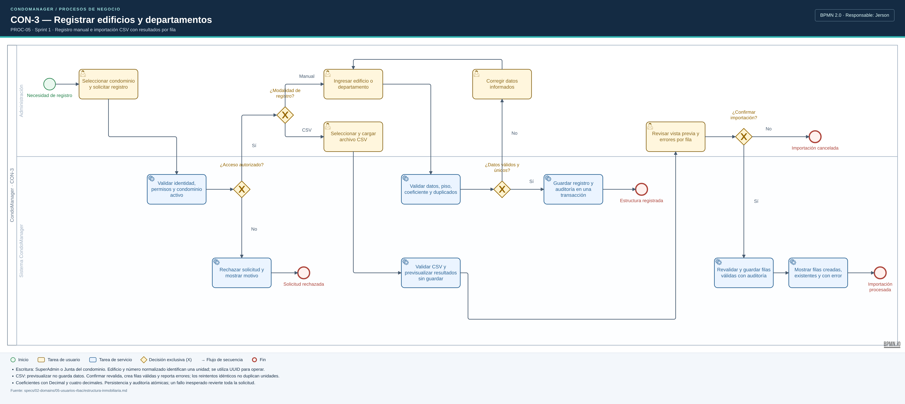
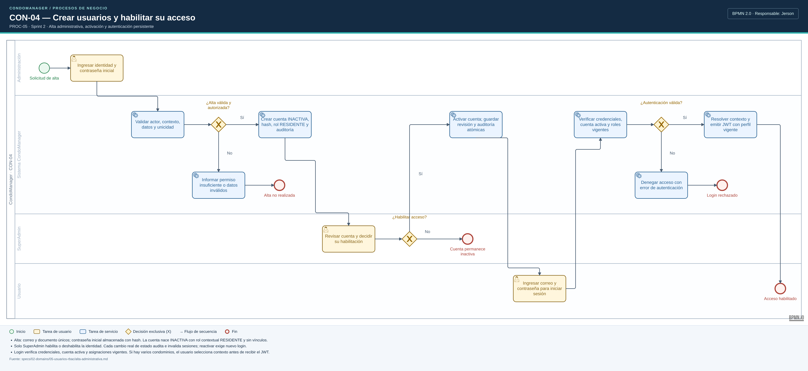
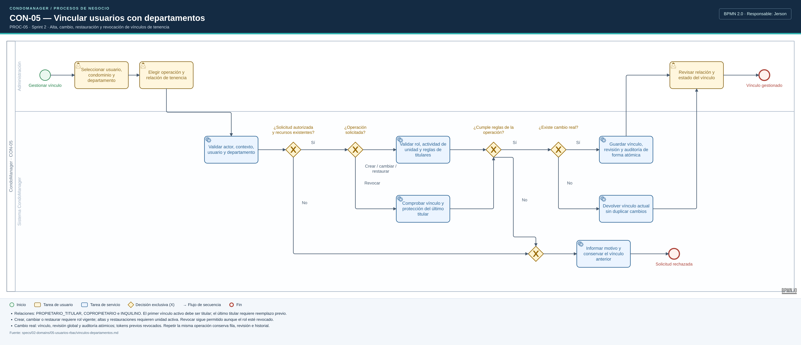
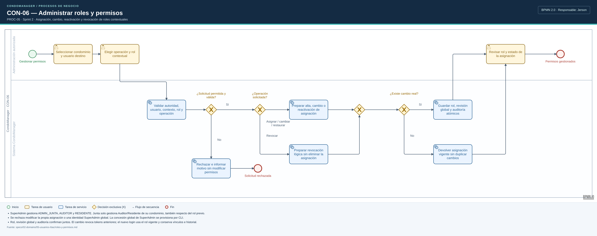
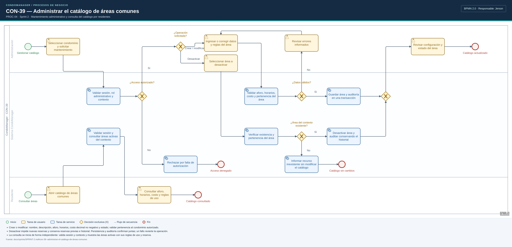

# Diagramas BPMN 2.0 — Procesos de Jerson

Cinco diagramas de las historias asignadas a Jerson en los
[sprints 1](../../sprints/SPRINT-1.md) y [2](../../sprints/SPRINT-2.md).
El nombre de Jerson identifica al responsable de implementar la historia; los
carriles representan a quienes participan en el proceso de negocio.

## Imágenes y modelos editables

| Historia | Imagen PNG | Fuente BPMN 2.0 |
|---|---|---|
| CON-3 — Edificios, departamentos e importación CSV | [Ver imagen](CON-3-edificios-departamentos.png) | [Modelo editable](CON-3-edificios-departamentos.bpmn) |
| CON-04 — Alta y habilitación de usuarios | [Ver imagen](CON-04-alta-habilitacion-usuarios.png) | [Modelo editable](CON-04-alta-habilitacion-usuarios.bpmn) |
| CON-05 — Vínculos entre usuarios y departamentos | [Ver imagen](CON-05-vinculos-usuarios-departamentos.png) | [Modelo editable](CON-05-vinculos-usuarios-departamentos.bpmn) |
| CON-06 — Roles y permisos | [Ver imagen](CON-06-roles-permisos.png) | [Modelo editable](CON-06-roles-permisos.bpmn) |
| CON-39 — Catálogo de áreas comunes | [Ver imagen](CON-39-catalogo-areas-comunes.png) | [Modelo editable](CON-39-catalogo-areas-comunes.bpmn) |

Las imágenes tienen fondo blanco, orientación horizontal y resolución 2×.
Los modelos incluyen los elementos semánticos BPMN y la disposición gráfica
BPMN DI, por lo que se pueden abrir en [bpmn.io](https://demo.bpmn.io/).
Son modelos descriptivos (`isExecutable="false"`); las condiciones de las
compuertas se expresan en lenguaje natural.

## Convenciones y alcance

- Un pool **CondoManager**, con carriles de Administración, Sistema y, cuando
  corresponde, SuperAdmin y Usuario/Residente.
- Inicio: círculo verde. Fin: círculo rojo de borde grueso.
- Tarea de usuario: rectángulo redondeado amarillo con marcador de persona.
- Tarea de servicio: rectángulo redondeado azul con marcador de engranajes.
- Compuerta exclusiva: rombo con **X**. Sus salidas están etiquetadas.
- Las flechas continuas son flujos de secuencia entre actividades del mismo pool.
- Los pies de imagen resumen las reglas de negocio y las garantías transaccionales.

Las especificaciones vigentes de cada historia prevalecen sobre las guías generales:

- **CON-3:** [estructura inmobiliaria](../../../specs/02-domains/05-usuarios-rbac/estructura-inmobiliaria.md).
  El CSV se previsualiza y luego se confirma; los errores de datos son por fila y
  los reintentos idénticos no duplican unidades.
- **CON-04:** [alta administrativa](../../../specs/02-domains/05-usuarios-rbac/alta-administrativa.md).
  El administrador establece la contraseña inicial; la cuenta nace inactiva y el
  SuperAdmin decide su habilitación. Resolver contexto incluye la selección del
  condominio cuando existen varias asignaciones válidas.
- **CON-05:** [vínculos persistentes](../../../specs/02-domains/05-usuarios-rbac/vinculos-departamentos.md).
  Se protege al último titular y se distinguen las condiciones de alta/restauración
  de las de revocación. Propietario, copropietario e inquilino son relaciones de tenencia.
- **CON-06:** [roles y permisos](../../../specs/02-domains/05-usuarios-rbac/roles-y-permisos.md).
  La autoridad del actor limita las asignaciones contextuales. La concesión global
  de SuperAdmin se administra mediante CLI.
- **CON-39:** [alcance del Sprint 2](../../sprints/SPRINT-2.md#con-39--administrar-el-catálogo-de-áreas-comunes).
  Incluye mantenimiento y una entrada independiente para consultar el catálogo;
  crear una reserva corresponde a otras historias.

## Regeneración

Requisitos: Python 3.11+, Node/npm para obtener **bpmn-js 18.31.1** y Google Chrome
o Chromium. El generador usa la biblioteca estándar de Python. Los PNG se obtienen
renderizando los propios XML con el visor BPMN; se comprueba que el visor los
importe sin errores ni advertencias.

Desde la raíz del repositorio, con `/tmp/opencode` existente:

```bash
npm install --prefix /tmp/opencode/bpmn-render --no-audit --no-fund bpmn-js@18.31.1
python3 docs/diagramas/jerson/generar_diagramas.py \
  --viewer /tmp/opencode/bpmn-render/node_modules/bpmn-js/dist/bpmn-viewer.production.min.js
```

Puede indicarse otro navegador con `--chrome /ruta/al/ejecutable`.
Para regenerar solo los modelos, basta con Python:

```bash
python3 docs/diagramas/jerson/generar_diagramas.py --solo-bpmn
```

Los flujos y sus posiciones están definidos en `generar_diagramas.py`. Al editar
manualmente un `.bpmn` en un modelador, conservar esa edición antes de regenerar:
el comando reconstruye los cinco modelos a partir de esas definiciones.

El generador comprueba conectividad desde inicio hasta fin, pertenencia de los
nodos a sus carriles, condiciones de salida de las compuertas y que las flechas
no atraviesen otras actividades.

Para comprobar además los cinco modelos contra los esquemas XSD de BPMN 2.0,
con `xmllint` instalado:

```bash
xmllint --noout \
  --schema /tmp/opencode/bpmn-render/node_modules/bpmn-moddle/resources/bpmn/xsd/BPMN20.xsd \
  docs/diagramas/jerson/*.bpmn
```

## Vistas previas

### CON-3 — Registrar edificios y departamentos



### CON-04 — Crear usuarios y habilitar su acceso



### CON-05 — Vincular usuarios con departamentos



### CON-06 — Administrar roles y permisos



### CON-39 — Administrar el catálogo de áreas comunes


